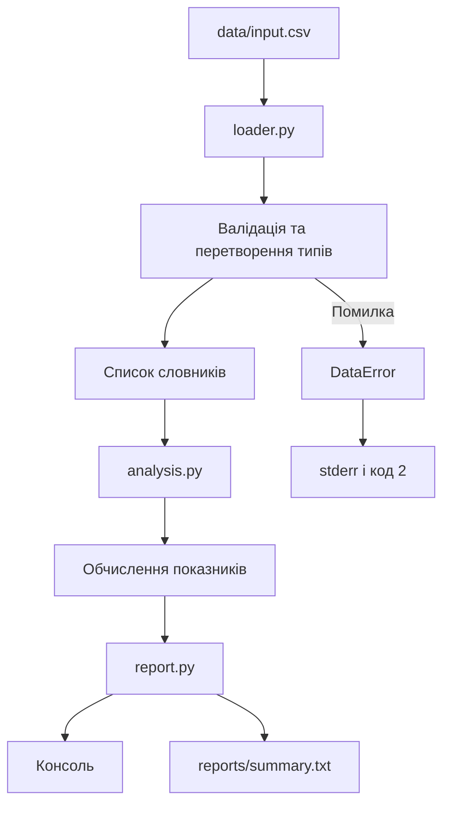

# Звіт до лабораторної роботи №1

## 1. Тема, номер роботи та варіант

**Тема:** «Розгортання Java-проєкту та базова обробка даних».

**Дисципліна:** «Кросплатформні засоби програмування».

**Варіант:** №9 — «Комунальні показники».

**Операційна система:** Windows.

**Java:** 21.

**Репозиторій:** `kzp-labs-Kolodij`.

**Робоча гілка:** `lab1`.

---

## 2. Мета роботи

Створити консольну Java-програму для обробки даних варіанта №9 та підготувати повний інженерний цикл: Maven, автоматизовані тести, статичний аналіз, виконуваний JAR і CI на трьох операційних системах.

---

## 3. Постановка задачі

Формат одного запису:

```text
meter;date;value;tariff
```

Поля:

- `meter` — назва або ідентифікатор лічильника;
- `date` — дата;
- `value` — значення споживання;
- `tariff` — тариф.

Для коректних записів програма обчислює:

1. кількість коректних записів;
2. сумарне споживання;
3. загальну вартість;
4. найбільше споживання.

Некоректний рядок не завершує роботу програми. Для нього виводиться номер рядка та причина пропуску.

---

## 4. Реалізація і структура

Основний клас:

```text
src/main/java/ua/lpnu/kzp/Main.java
```

Тести:

```text
src/test/java/ua/lpnu/kzp/MainTest.java
```

Основні допоміжні методи `Main`:

- `printHelp()` — виведення довідки;
- `printVersion()` — виведення версії програми;
- `readInput()` — читання UTF-8 файла;
- `processLines()` — перевірка записів і обчислення;
- `formatReport()` — формування звіту;
- `writeReport()` — запис звіту у файл.

Для роботи зі шляхами використовується `Path`, для текстових файлів — `StandardCharsets.UTF_8`, для форматування чисел — `Locale.ROOT`.

---

## 5. Інфраструктура

Проєкт використовує Maven і Maven Wrapper.

У `pom.xml` налаштовано:

- Java 21;
- UTF-8;
- JUnit 5;
- SpotBugs;
- Maven Shade Plugin;
- версію `1.0.0`.

Основні команди:

```powershell
.\mvnw.cmd test
.\mvnw.cmd verify
.\mvnw.cmd package
```

Виконуваний JAR:

```text
target/lab01-1.0.0.jar
```

Запуск:

```powershell
java -jar target\lab01-1.0.0.jar
```

Перевірка версії:

```powershell
java -jar target\lab01-1.0.0.jar --version
```

Локальний результат:

```text
Version 1.0.0
```

SpotBugs запускається у фазі `verify` і не виявив дефектів:

```text
BugInstance size is 0
Error size is 0
No errors/warnings found
BUILD SUCCESS
```

---

## 6. GitHub Issues і CI

Для роботи створено GitHub Issues:

- **#1** — налаштування лабораторної роботи №1;
- **#2** — налаштування Maven-проєкту;
- **#3** — аналізатор і пакування;
- **#4** — GitHub Actions.

GitHub Actions налаштовано у файлі:

```text
.github/workflows/ci.yml
```

Workflow запускається під час:

- `push`;
- `pull_request`.

CI виконує `verify` на:

- `ubuntu-latest`;
- `windows-latest`;
- `macos-latest`.

На всіх трьох ОС використовується Java 21 та Maven Wrapper.

Усі три CI jobs завершуються успішно.

Після перевірки JAR публікується як workflow artifact.

Приклад назви artifact:

```text
jar-windows-latest-4
```

У ньому зберігається:

```text
lab01-1.0.0.jar
```

Посилання на фінальний CI run:

```text
<https://github.com/snizhanakolodiiki2024-lab/kzp-labs-Kolodij/actions/runs/35855059107>
```

Посилання на artifact:

```text
<https://github.com/snizhanakolodiiki2024-lab/kzp-labs-Kolodij/actions/runs/35855059107/artifacts/10746339445>
```

Фінальний Pull Request буде створено з:

```text
lab1 → main
```

---

## 7. Приклад роботи

Фрагмент `data/input.csv`:

```text
Електролічильник-1;2026-09-01;125.50;4.32
Водомір-1;2026-09-02;12.75;35.20
Електролічильник-2;2026-09-03;48.00;4.32
Теплолічильник-1;2026-09-04;-10.00;8.50
Водомір-2;2026-09-05;abc;35.20
Електролічильник-3;;90.00;4.32
Газовий-лічильник;2026-09-07;33.00
```

Перші три записи є коректними, інші містять різні помилки.

Результат:

```text
Результати:
Кількість коректних записів: 3
Сумарне споживання: 186.25
Загальна вартість: 1198.32
Найбільше споживання: 125.50
```

---

## 8. Тестування

Для тестування використовується JUnit 5.

Реалізовано 7 тестів:

1. коректні й некоректні записи;
2. порожній рядок, порожня дата та неправильна кількість полів;
3. файл без коректних записів;
4. параметр `--version`;
5. порожній `meter`;
6. від’ємний `tariff`;
7. невідомий аргумент.

Локальний результат:

```text
Tests run: 7, Failures: 0, Errors: 0, Skipped: 0
BUILD SUCCESS
```

Після рефакторингу всі тести продовжили успішно проходити.

У GitHub Actions ті самі перевірки виконуються на Ubuntu, Windows і macOS.

---

## 9. Додаткове завдання із зірочкою

У GitHub Actions налаштовано кеш Maven-залежностей:

```yaml
cache: maven
```

Для автоматичного номера CI-збірки використовується:

```text
github.run_number
```

Номер збірки передається програмі через змінну середовища:

```text
CI_BUILD_NUMBER
```

Тому локально:

```text
Version 1.0.0
```

а в CI, наприклад:

```text
Version 1.0.0 (build 4)
```

Номер CI-збірки також використовується у назві artifact:

```text
jar-windows-latest-4
```

### Версія продукту і номер CI-збірки

`1.0.0` — це версія продукту. Вона описує стан вихідного коду відповідного релізу.

`build 4` — це номер конкретного запуску GitHub Actions. Він автоматично збільшується при нових запусках workflow.

Ці значення не слід плутати, оскільки одна версія продукту `1.0.0` може бути зібрана в CI декілька разів і мати різні номери збірок.

---

## 10. Документація

Оновлено:

- `README.md`;
- `REPORT.md`;
- Javadoc у `Main.java`.

У каталозі `ai/` створено ролі:

- `Manager`;
- `DevOps`;
- `Developer`;
- `Validator`;
- `Documenter`;
- `Reviewer`.

---

## 11. Академічна доброчесність

Під час виконання лабораторної роботи використовувався ChatGPT як допоміжний інструмент.

ШІ використовувався для:

- пояснення методичних вимог;
- планування етапів роботи;
- пояснення Java, Maven, Git і GitHub;
- аналізу тестів;
- налаштування SpotBugs;
- налаштування GitHub Actions;
- перевірки кросплатформності;
- перевірки документації.

Усі команди, зміни та результати перевірялися автором роботи.

Автор може пояснити використані конструкції, структуру програми, Maven-конфігурацію, тести та CI.

---

## 12. Короткі відповіді на контрольні питання

1. `pom.xml` описує Maven-проєкт, залежності, Java-версію та плагіни.

2. `main` є точкою входу в консольну Java-програму.

3. `String[] args` містить аргументи командного рядка.

4. `--help` показує доступні параметри запуску.

5. `--input` задає шлях до вхідного файла.

6. `--output` задає шлях до файла звіту.

7. `--version` показує версію програми та, у CI, номер збірки.

8. `Path` використовується для кросплатформної роботи зі шляхами.

9. Явне UTF-8 забезпечує однакове кодування на різних ОС.

10. `split(";", -1)` зберігає порожні поля.

11. `Double.parseDouble` перетворює текст у `double`. Для неправильного числа виникає `NumberFormatException`.

12. Некоректний рядок не змінює статистику.

13. `Locale.ROOT` забезпечує крапку як десятковий роздільник.

14. `%n` створює правильний для поточної ОС перенос рядка.

15. Maven Wrapper дозволяє використовувати проєкт без залежності від локально встановленої версії Maven.

16. `test` запускає тести, `package` створює JAR, `verify` запускає повну перевірку зі SpotBugs.

17. SpotBugs шукає потенційні дефекти у скомпільованому коді.

18. GitHub Actions автоматично перевіряє однаковий код на різних ОС.

19. GitHub Issue описує окреме завдання або дефект.

20. Pull Request використовується для code review і злиття перевірених змін у `main`.

21. Версія продукту `1.0.0` описує реліз програми, а номер CI-збірки показує конкретний запуск workflow.

---

## 13. Висновки

У лабораторній роботі реалізовано консольний Java-застосунок для варіанта №9 **«Комунальні показники»**.

Програма читає UTF-8 файл, перевіряє записи, пропускає некоректні дані з поясненням причини, обчислює чотири показники та формує звіт.

Проєкт використовує Maven Wrapper, JUnit 5, SpotBugs і Maven Shade Plugin.

Реалізовано 7 автоматизованих тестів.

GitHub Actions успішно перевіряє проєкт на Ubuntu, Windows і macOS та публікує виконуваний JAR як artifact.

Виконано додаткове завдання: налаштовано Maven cache, автоматичний номер CI-збірки, його відображення через `--version` та використання у назві artifact.

Поточна версія програми:

```text
1.0.0
```

Фінальний Git-тег:

```text
v1.0.0
```

# Лабораторна робота №2

## 1. Загальна інформація

- **Дисципліна:** Кросплатформні засоби програмування
- **Варіант:** №9
- **Предметна область:** комунальні показники
- **Java:** 21
- **ОС:** Windows
- **Гілка:** `lab2`
- **Версія:** `2.0.0`

Репозиторій:

```text
https://github.com/snizhanakolodiiki2024-lab/kzp-labs-Kolodij
```

## 2. Мета роботи

Мета роботи — перебудувати предметну частину програми з лабораторної роботи №1: замінити рядкове представлення об'єктною моделлю, перенести валідацію до класу-сутності, додати `record`, автоматизовані тести та зберегти зовнішню поведінку програми.

## 3. Реалізація

Основна сутність:

```java
UtilityReading
```

Поля:

```java
private final String meter;
private final String date;
private final double value;
private final double tariff;
```

`UtilityReading` оголошено як `final`, усі поля `private final`, setter-и відсутні.

Конструктор перевіряє:

- `meter` і `date` не є `null` або blank;
- `value >= 0`;
- `tariff >= 0`;
- числові значення є скінченними.

Для перевірки використано:

```java
Double.isFinite(...)
```

Тому `NaN`, `Infinity` та `-Infinity` не допускаються.

Створення з CSV:

```java
UtilityReading.fromCsv(String line)
```

Формат:

```text
meter;date;value;tariff
```

Фабричний метод перевіряє структуру CSV та числові поля, а предметна валідація залишається в конструкторі.

Допоміжне незмінне значення:

```java
record ConsumptionCost(double consumption, double cost)
```

`ConsumptionCost` використовується під час обчислення споживання та вартості.

Метод `toString()` перевизначено з використанням `Locale.ROOT`, тому формат дробових чисел не залежить від локалі операційної системи.

## 4. Порівняння Lab 1 і Lab 2

| Характеристика | Lab 1 | Lab 2 |
| --- | --- | --- |
| Представлення запису | рядок та окремі змінні | `UtilityReading` |
| Розбір CSV | у `Main` | `UtilityReading.fromCsv()` |
| Валідація | у циклі обробки | у конструкторі |
| Набір даних | окремі значення | `List<UtilityReading>` |
| Допоміжні значення | окремі змінні | `ConsumptionCost` |
| Незмінність | не реалізовувалась окремо | `final`, `private final`, без setter-ів |
| Створення об'єкта | конструктор | конструктор + `Builder` |
| Перевірка `NaN` / Infinity | неповна | `Double.isFinite()` |
| Кількість тестів | 7 | 38 |
| Версія | `1.0.0` | `2.0.0` |
| JAR | `lab01-1.0.0.jar` | `lab01-2.0.0.jar` |

## 5. Тестування

Додано:

- `UtilityReadingTest`;
- `ConsumptionCostTest`;
- додаткові перевірки в `MainTest`;
- тести `UtilityReading.Builder`.

Перевіряються:

- коректні та граничні значення;
- `null` і blank;
- від'ємні значення;
- `NaN`;
- `Infinity`;
- `-Infinity`;
- `fromCsv()`;
- неправильна кількість CSV-полів;
- неправильний числовий формат;
- порушення інваріантів;
- `ConsumptionCost`;
- рівність і компоненти `record`;
- коди завершення програми;
- створення через Builder;
- неможливість обходу валідації через Builder;
- відсутність обов'язкових полів Builder.

Локальний результат:

```text
Tests run: 38, Failures: 0, Errors: 0, Skipped: 0
BUILD SUCCESS
```

Старі тести лабораторної роботи №1 продовжують проходити.

## 6. Maven, SpotBugs і JAR

Повна перевірка:

```powershell
.\mvnw.cmd clean verify
```

Результат SpotBugs:

```text
BugInstance size is 0
Error size is 0
No errors/warnings found
BUILD SUCCESS
```

Пакування:

```powershell
.\mvnw.cmd package
```

Поточний JAR:

```text
target/lab01-2.0.0.jar
```

Перевірка версії:

```powershell
java -jar target\lab01-2.0.0.jar --version
```

Результат:

```text
Version 2.0.0
```

Запуск JAR:

```powershell
java -jar target\lab01-2.0.0.jar --input data\input.csv --output out\report-lab2.txt
```

JAR успішно запускається, а підсумкові показники збігаються з лабораторною роботою №1.

## 7. GitHub Actions

CI запускається на:

| ОС | Результат |
| --- | --- |
| Ubuntu | Success |
| Windows | Success |
| macOS | Success |

Актуальний зелений workflow:

```text
https://github.com/snizhanakolodiiki2024-lab/kzp-labs-Kolodij/actions/runs/38093321839
```

У цьому запуску:

- виконано Maven `verify`;
- виконано 38 тестів;
- запущено SpotBugs;
- перевірено версію;
- опубліковано 3 JAR artifacts.

JAR artifacts доступні на сторінці цього workflow.

## 8. GitHub Issues і Pull Request

| Issue | Виконана робота | Перевірка |
| --- | --- | --- |
| `#6` | `UtilityReading`, `fromCsv()`, перенесення валідації | старі 7 тестів, контрольний звіт |
| `#7` | `ConsumptionCost` та автоматизовані тести | 35 тестів без помилок |
| `#8` | Maven, SpotBugs, JAR | `BUILD SUCCESS`, SpotBugs: 0 дефектів |
| `#9` | CI, artifacts, версія `2.0.0` | Ubuntu, Windows, macOS — Success |
| `#10` | Immutable `UtilityReading` та Builder ⭐ | 38 тестів, Builder validation |

Гілка:

```text
lab2
```

Фінальний Pull Request:

```text
https://github.com/snizhanakolodiiki2024-lab/kzp-labs-Kolodij/pull/11
```

CI на Pull Request успішно пройшов на Ubuntu, Windows і macOS.

У фінальному Pull Request буде використано:

```text
Closes #6
Closes #7
Closes #8
Closes #9
Closes #10
```

## 9. Порівняння результатів

Для контрольного набору даних результат до і після рефакторингу однаковий:

| Показник | Lab 1 | Lab 2 |
| --- | ---: | ---: |
| Коректних записів | 3 | 3 |
| Сумарне споживання | 186.25 | 186.25 |
| Загальна вартість | 1198.32 | 1198.32 |
| Найбільше споживання | 125.50 | 125.50 |

Отже внутрішня структура програми змінилася, але зовнішня поведінка залишилася сумісною з лабораторною роботою №1.

## 10. Академічна доброчесність

Під час виконання роботи використовувався ChatGPT як допоміжний інструмент.

Використовувалися ролі:

- Менеджера — планування Issues і рівнів виконання;
- Розробника — реалізація предметної моделі;
- Валідатора — перевірка інваріантів і тестів;
- DevOps — Maven, SpotBugs і GitHub Actions;
- Документатора — README, REPORT і javadoc;
- Рецензента — перевірка сумісності поведінки до і після рефакторингу.

Основні запити до ШІ стосувалися:

- аналізу методичних вимог;
- структури `UtilityReading`;
- реалізації `ConsumptionCost`;
- формування тестів;
- аналізу Maven та SpotBugs;
- налаштування CI;
- оформлення README і REPORT.

Прийняті рекомендації:

- використання `Double.isFinite()`;
- централізація предметної валідації в конструкторі;
- використання `ConsumptionCost`;
- перевірка ненульових exit codes;
- тести `NaN`, `Infinity` та `-Infinity`;
- Builder через основний конструктор;
- CI на трьох ОС.

Відхилені або скориговані пропозиції:

- відхилено залишення однакової реалізації `calculateCost()` для `ElectricityReading` і `WaterReading`, оскільки це не демонструвало різну поведінку підтипів;
- початкову реалізацію валідації безпосередньо в конструкторі абстрактного `UtilityReading` скориговано після попередження SpotBugs `CT_CONSTRUCTOR_THROW`.

Під час роботи виправлено:

- приймання `NaN` та нескінченних чисел;
- некоректні exit codes для помилкових сценаріїв;
- застарілі версії GitHub Actions;
- перевірку Builder без обходу конструктора.

Усі зміни перевірялися власноруч через тести, Maven `verify`, запуск JAR та GitHub Actions.

## 11. Відповіді на контрольні питання

1. Клас-сутність об'єднує пов'язані дані в один об'єкт і зменшує ризик переплутати окремі значення.

2. `private` приховує поле від прямого доступу, а `final` забороняє його переприсвоєння після створення об'єкта.

3. Інкапсуляція приховує внутрішній стан і дозволяє контролювати спосіб роботи з ним.

4. Перевірка в конструкторі гарантує, що некоректний об'єкт не буде створено.

5. `Objects.requireNonNull` перевіряє `null`, а `isBlank()` — порожній рядок або рядок із пробілів.

6. Без setter-ів перевірений стан не можна довільно змінити після створення.

7. `record` автоматично отримує конструктор, accessor-и, `equals()`, `hashCode()` і `toString()`.

8. `record` зручний для компактних незмінних наборів даних, а звичайний клас дає більше контролю над структурою та поведінкою.

9. Якщо компонент record містить змінний об'єкт, його внутрішній стан усе одно можна змінити.

10. `fromCsv()` перетворює один CSV-рядок на готовий предметний об'єкт.

11. Помилку одного рядка потрібно перехоплювати в циклі читання, щоб інші записи продовжили оброблятися.

12. Некоректний запис не можна додавати до списку, інакше він вплине на статистику.

13. `toString()` призначений для текстового представлення об'єкта, а CSV має окремий формат.

14. `Locale.ROOT` забезпечує незалежне від локалі форматування дробових чисел.

15. AAA: Arrange — підготовка, Act — виконання, Assert — перевірка результату.

16. Для конструктора потрібно тестувати `null`, blank, від'ємні значення, `NaN`, `Infinity` та граничні значення.

17. Сумісність доводиться однаковим результатом програми на тому самому контрольному наборі даних.

18. Старі тести мають проходити, тому що рефакторинг не повинен ламати вже реалізовану поведінку.

19. Із попередньої роботи переносяться Maven Wrapper, `pom.xml`, CI, JUnit, SpotBugs, Shade Plugin та інша інфраструктура.

20. Приклад інкапсуляції:

```java
private final double value;
```

Поле приховане від прямого доступу та не може бути переприсвоєне після створення об'єкта.

## 12. Додаткове завдання ⭐ — Immutable та Builder

`UtilityReading` є повністю незмінним:

- клас `final`;
- поля `private final`;
- setter-и відсутні.

Для зручного створення об'єктів реалізовано:

```java
UtilityReading.Builder
```

Приклад:

```java
UtilityReading reading = UtilityReading.builder()
        .meter("Водомір-1")
        .date("2026-09-01")
        .value(10.0)
        .tariff(2.5)
        .build();
```

Метод `build()` викликає основний конструктор `UtilityReading`, тому Builder не обходить валідацію.

Додано 3 тести:

- коректне створення;
- відхилення некоректного значення;
- відхилення відсутніх обов'язкових полів.

Незмінність зменшує ризик помилок під час передавання об'єктів між потоками: після створення стан `UtilityReading` більше не змінюється, тому інший потік не може несподівано змінити його поля.

## 13. Висновки

У лабораторній роботі №2:

- створено `UtilityReading`;
- валідацію перенесено до предметної моделі;
- додано `fromCsv()`;
- створено `ConsumptionCost`;
- додано `toString()` з `Locale.ROOT`;
- виправлено обробку `NaN` та нескінченних значень;
- `UtilityReading` залишено повністю незмінним;
- реалізовано `UtilityReading.Builder`;
- Builder не обходить валідацію конструктора;
- кількість тестів збільшено з 7 до 38;
- SpotBugs не виявляє дефектів;
- версію оновлено до `2.0.0`;
- CI успішно працює на Ubuntu, Windows і macOS;
- JAR публікується як artifact;
- результати Lab 1 і Lab 2 залишилися однаковими.

Отримана об'єктна модель є основою для лабораторної роботи №3.

Git-тег фінальної версії:

```text
v2.0.0
```

Посилання:

```text
https://github.com/snizhanakolodiiki2024-lab/kzp-labs-Kolodij/tree/v2.0.0
```

# Лабораторна робота №3

## 1. Загальна інформація

- **Дисципліна:** Кросплатформні засоби програмування
- **Тема:** спадкування, інтерфейси й поліморфізм у Java-проєкті
- **Варіант:** №9
- **Предметна область:** комунальні показники
- **Java:** 21
- **ОС:** Windows
- **Гілка:** `lab3`
- **Версія:** `3.0.0`

Репозиторій:

```text
https://github.com/snizhanakolodiiki2024-lab/kzp-labs-Kolodij
```

## 2. Мета роботи

Мета роботи — розширити об'єктну модель лабораторної роботи №2 за допомогою спадкування, enum і поліморфізму.

Спільні поля та інваріанти винесено до базового типу, створено два підтипи з різною поведінкою, реалізовано `equals()` і `hashCode()`, а обробка різних об'єктів виконується через спільний тип.

Формат CSV і зовнішній звіт попередньої роботи збережено.

## 3. Стан до і після роботи

У Lab 2 використовувався один клас:

```java
UtilityReading
```

Розрахунок вартості виконувався в `Main`:

```java
reading.getValue() * reading.getTariff()
```

У Lab 3 створено ієрархію:

```text
UtilityReading
├── ElectricityReading
└── WaterReading
```

Розрахунок вартості перенесено до поліморфного методу:

```java
calculateCost()
```

Тепер `Main` не визначає конкретний підтип під час обчислення вартості.

## 4. Базовий тип UtilityReading

`UtilityReading` став абстрактним базовим класом.

Спільні поля:

```java
private final String meter;
private final String date;
private final double value;
private final double tariff;
```

Для всіх підтипів спільними є правила:

- `meter` і `date` не можуть бути `null` або blank;
- `value` не може бути від'ємним;
- `tariff` не може бути від'ємним;
- числові значення повинні бути скінченними.

Для перевірки чисел використовується:

```java
Double.isFinite(...)
```

Спільна валідація визначена в базовому типі через методи:

```java
validateMeter(...)
validateDate(...)
validateValue(...)
validateTariff(...)
```

Поліморфні операції:

```java
public abstract UtilityKind getKind();

public abstract double calculateCost();
```

Абстрактний клас обрано замість інтерфейсу, оскільки підтипи мають спільний стан, спільні інваріанти та готову частину реалізації.

`ElectricityReading` і `WaterReading` успадковують `UtilityReading`, оскільки є його різновидами, тобто між ними існує відношення `is-a`.

`ConsumptionCost` не є різновидом `UtilityReading`, тому для нього використовується окремий об'єкт, а не спадкування. Це є прикладом застосування композиції замість успадкування.

## 5. Підтипи

Створено два підтипи:

```text
ElectricityReading
WaterReading
```

### ElectricityReading

Додаткове поле:

```java
private final double tariffCoefficient;
```

Стандартне значення:

```text
1.0
```

Розрахунок:

```java
@Override
public double calculateCost() {
    return getValue()
            * getTariff()
            * tariffCoefficient;
}
```

### WaterReading

Додаткове поле:

```java
private final double serviceFee;
```

Стандартне значення:

```text
0.0
```

Розрахунок:

```java
@Override
public double calculateCost() {
    return getValue()
            * getTariff()
            + serviceFee;
}
```

Таким чином підтипи мають різні поля, правила та реалізації одного поліморфного методу.

Стандартні значення додаткових полів забезпечують сумісність із CSV лабораторної роботи №2.

## 6. UtilityKind

Для фіксованого набору категорій створено enum:

```java
UtilityKind
```

Значення:

```text
ELECTRICITY
WATER
```

Кожен підтип повертає власну категорію через:

```java
getKind()
```

Наприклад:

```java
UtilityKind.ELECTRICITY
UtilityKind.WATER
```

## 7. equals() і hashCode()

У базовому типі реалізовано:

```java
equals()
hashCode()
```

Логічна рівність враховує:

```text
конкретний підтип
meter
date
value
tariff
```

а також специфічний стан підтипу:

```text
ElectricityReading -> tariffCoefficient
WaterReading       -> serviceFee
```

Тому об'єкти різних підтипів не є рівними навіть за однакових спільних полів.

Роботу `equals()` і `hashCode()` перевірено через:

```java
HashSet<UtilityReading>
```

Два логічно рівні об'єкти утворюють лише один елемент множини.

## 8. Поліморфізм

Різні підтипи зберігаються у спільній колекції:

```java
List<UtilityReading>
```

Обробка виконується через базовий тип:

```java
for (UtilityReading reading : readings) {
    double cost = reading.calculateCost();
}
```

Під час виконання Java самостійно вибирає реалізацію:

```text
ElectricityReading.calculateCost()
```

або:

```text
WaterReading.calculateCost()
```

У коді розрахунку немає центральної перевірки:

```java
if (reading instanceof ElectricityReading)
```

і немає `switch` за конкретним підтипом.

Це дозволяє відокремити поведінку кожного підтипу від коду формування звіту.

## 9. Тестування

Попередні тести Lab 1 і Lab 2 збережено.

Для Lab 3 додано тести:

```text
ElectricityReadingTest
WaterReadingTest
UtilityKindTest
PolymorphismTest
UtilityReadingEqualityTest
```

Перевіряються:

- спільні інваріанти базового типу;
- обидва підтипи;
- різні реалізації `calculateCost()`;
- додаткові поля підтипів;
- `UtilityKind`;
- поліморфна колекція `List<UtilityReading>`;
- позитивні, граничні та негативні випадки;
- `equals()` і `hashCode()`;
- робота рівності в `HashSet`;
- нерівність різних підтипів;
- попередня поведінка програми.

Результат:

```text
Tests run: 58, Failures: 0, Errors: 0, Skipped: 0
BUILD SUCCESS
```

## 10. Maven, SpotBugs, JAR і CI

Запуск тестів:

```powershell
.\mvnw.cmd test
```

Повна перевірка:

```powershell
.\mvnw.cmd verify
```

Пакування:

```powershell
.\mvnw.cmd package
```

Усі команди завершуються:

```text
BUILD SUCCESS
```

SpotBugs після виправлень не знаходить дефектів.

Поточний JAR:

```text
target/lab01-3.0.0.jar
```

Перевірка версії:

```powershell
java -jar target\lab01-3.0.0.jar --version
```

Результат:

```text
Version 3.0.0
```

GitHub Actions запускає перевірки на:

| ОС | Результат |
| --- | --- |
| Ubuntu | Success |
| Windows | Success |
| macOS | Success |

JAR публікується як workflow artifact для кожної ОС.

## 11. GitHub Issues і Pull Request

Для Lab 3 створено:

| Issue | Виконана робота | Перевірка |
| --- | --- | --- |
| `#12` | `UtilityReading`, `ElectricityReading`, `WaterReading`, `UtilityKind`, поліморфізм | тести підтипів і контрольний звіт |
| `#13` | `equals()`, `hashCode()`, автоматизовані тести | `HashSet`, 58 тестів |
| `#14` | Maven, SpotBugs та виконуваний JAR | `verify`, SpotBugs, запуск JAR |
| `#15` | CI, документація, версія та реліз | Windows, Ubuntu, macOS |

Гілка:

```text
lab3
```

Фінальний Pull Request:
```text
#16 — Lab3: inheritance, polymorphism, equality and sealed hierarchy
```
Посилання:
```text
https://github.com/snizhanakolodiiki2024-lab/kzp-labs-Kolodij/pull/16
```
Злиття виконано:
```text
lab3 -> main
```
У Pull Request використано:
```text
Closes #12
Closes #13
Closes #14
Closes #15
```
Після merge Issues #12, #13, #14 і #15 автоматично закрито.
CI на Pull Request успішно пройшов на Ubuntu, Windows і macOS. Усі перевірки завершилися успішно.

## 12. Порівняння Lab 2 і Lab 3

| Характеристика | Lab 2 | Lab 3 |
| --- | --- | --- |
| Базова модель | один `UtilityReading` | абстрактний `UtilityReading` |
| Типи показників | один клас | `ElectricityReading`, `WaterReading` |
| Категорія | визначалася з даних | `UtilityKind` |
| Розрахунок вартості | `value * tariff` у `Main` | поліморфний `calculateCost()` |
| Обробка | `List<UtilityReading>` | `List<UtilityReading>` з різними підтипами |
| Рівність | стандартна `Object` | `equals()` + `hashCode()` |
| Перевірка колекції | не використовувалась | `HashSet` |
| Кількість тестів | 38 | 58 |
| Версія | `2.0.0` | `3.0.0` |
| JAR | `lab01-2.0.0.jar` | `lab01-3.0.0.jar` |

### Порівняння складності реалізацій

У Lab 2 вартість кожного запису обчислювалася безпосередньо в `Main`:

```java
reading.getValue() * reading.getTariff()
```

У Lab 3 використовується поліморфний виклик:

```java
reading.calculateCost()
```

Для `n` коректних записів обидва варіанти мають часову складність:

```text
O(n)
```

оскільки кожен елемент колекції обробляється один раз.

За пам'яттю обидва способи не потребують додаткової структури, розмір якої залежить від кількості записів, тому додаткова складність обробки становить:

```text
O(1)
```

Перевага поліморфного варіанта полягає не в асимптотичній швидкості, а в розширюваності. У Lab 2 код обчислення залежав від зовнішньої логіки `Main`, а в Lab 3 кожен підтип сам реалізує `calculateCost()`.

Тому додавання нового підтипу не потребує зміни циклу формування статистики: він продовжує працювати через спільний тип `UtilityReading`.

Для контрольного набору даних результат не змінився:

| Показник | Lab 2 | Lab 3 |
| --- | ---: | ---: |
| Коректних записів | 3 | 3 |
| Сумарне споживання | 186.25 | 186.25 |
| Загальна вартість | 1198.32 | 1198.32 |
| Найбільше споживання | 125.50 | 125.50 |

Отже внутрішню модель перебудовано на поліморфну, але зовнішня поведінка програми залишилася сумісною з Lab 2.

## 13. Академічна доброчесність

Під час виконання лабораторної роботи використовувався ChatGPT як допоміжний інструмент.

Використовувалися ролі:

- Менеджера — планування рівнів роботи та GitHub Issues;
- Розробника — реалізація базового типу й підтипів;
- Валідатора — формування тестів поліморфізму та рівності;
- DevOps — Maven, SpotBugs, JAR і CI;
- Документатора — README, REPORT і Javadoc;
- Рецензента — перевірка відсутності розгалужень за конкретним підтипом.

Основні запити до ШІ стосувалися:

- аналізу методичних вимог;
- вибору базового типу;
- побудови ієрархії `UtilityReading`;
- реалізації підтипів;
- поліморфного `calculateCost()`;
- `equals()` і `hashCode()`;
- тестування через `HashSet`;
- Maven, SpotBugs і CI;
- оформлення README і REPORT.

Прийняті рекомендації:

- використати абстрактний клас через наявність спільного стану;
- винести різну поведінку до підтипів;
- використовувати `UtilityKind`;
- виконувати розрахунок через `reading.calculateCost()`;
- перевірити рівність через `HashSet`;
- зберегти формат CSV та контрольні результати попередньої роботи.

Під час роботи скориговано початкові рішення.

Початково обидва підтипи мали однакову формулу `value * tariff`, що не демонструвало різну поведінку. Тому для `ElectricityReading` додано `tariffCoefficient`, а для `WaterReading` — `serviceFee`.

SpotBugs також виявив:

```text
CT_CONSTRUCTOR_THROW
```

для конструктора абстрактного `UtilityReading`.

Після цього спільні правила валідації залишено в базовому типі у вигляді методів перевірки, а конструктор отримує вже перевірені значення.

Після виправлення:

```text
BugInstance size is 0
Error size is 0
BUILD SUCCESS
```

Усі зміни, команди та результати перевірялися автором роботи. Автор може пояснити структуру ієрархії, поліморфізм, enum, рівність, тести та Maven-конфігурацію.

## 14. Відповіді на контрольні питання

1. Базовий тип об'єднує спільні поля, інваріанти та операції різних комунальних показників і не дозволяє дублювати однаковий код у підтипах.

2. `extends` використовується для успадкування класу, а `implements` — для реалізації контракту інтерфейсу.

3. `abstract` забороняє створювати об'єкти занадто загального базового типу та дозволяє оголосити методи, реалізацію яких повинні надати підтипи.

4. `super(...)` викликає конструктор базового класу і передає йому спільну частину стану об'єкта.

5. `@Override` дозволяє компілятору перевірити, що метод справді перевизначає успадкований метод.

6. Поліморфізм дозволяє працювати з різними підтипами через один базовий тип. Під час виклику методу Java вибирає реалізацію фактичного об'єкта, тому не потрібен `if` за типом.

7. Абстрактний клас зручний, коли є спільний стан і готова реалізація. Інтерфейс краще використовувати для спільної можливості або контракту без необхідності спільних полів.

8. Відношення «є різновидом» означає спадкування, наприклад `WaterReading` є різновидом `UtilityReading`. Композиція означає, що один об'єкт містить або використовує інший об'єкт.

9. Enum із полями та методами дозволяє представити обмежений набір значень і додати до кожного значення пов'язану поведінку або текстовий підпис.

10. Значення enum можна порівнювати через `==`, тому що кожна enum-константа існує як єдиний екземпляр.

11. Якщо два об'єкти рівні за `equals()`, вони повинні мати однаковий `hashCode()`. Рівність також повинна бути рефлексивною, симетричною, транзитивною та стабільною, доки стан не змінюється.

12. Якщо поле, яке бере участь у `hashCode()`, змінити після додавання об'єкта до `HashMap`, об'єкт може опинитися не в тому hash bucket і перестати нормально знаходитися.

13. Різні підтипи можуть мати різну семантику і поведінку, тому однакових спільних полів недостатньо для логічної рівності.

14. Поліморфна колекція зберігає об'єкти різних підтипів як значення базового типу, а під час виклику методу використовується реалізація конкретного об'єкта.

15. Різну поведінку доводять тести, де `ElectricityReading` і `WaterReading` через змінну типу `UtilityReading` повертають різні результати `calculateCost()`.

16. Коректність рівності в `HashSet` доводиться тим, що два логічно рівні об'єкти мають однаковий `hashCode()` і створюють лише один елемент множини.

17. `sealed` обмежує перелік класів, які можуть безпосередньо успадковувати базовий тип, а `permits` визначає дозволені підтипи.

18. `switch` за підтипами не повинен повторювати логіку `calculateCost()`, оскільки це дублює код і нівелює перевагу поліморфізму.

19. Після перебудови потрібно зберегти попередні тести, формат CSV і контрольні показники звіту.

20. Найкраще перевагу поліморфізму демонструє виклик:

```java
reading.calculateCost();
```

де `reading` має тип `UtilityReading`, а потрібна реалізація вибирається автоматично залежно від фактичного підтипу.

## 15. Додаткове завдання ⭐ — sealed-ієрархія

Базовий клас `UtilityReading` оголошено як:

```java
public abstract sealed class UtilityReading
        permits ElectricityReading, WaterReading
```

Ключове слово `sealed` обмежує перелік класів, які можуть безпосередньо успадковувати `UtilityReading`.

Дозволені підтипи:

```text
ElectricityReading
WaterReading
```

Обидва підтипи оголошені як `final`.

Для демонстрації перевірки вичерпності створено метод із pattern matching у `switch`:

```java
return switch (reading) {
    case ElectricityReading electricity -> ...
    case WaterReading water -> ...
};
```

Гілка `default` відсутня. Компілятор Java може перевірити вичерпність `switch`, оскільки знає всі дозволені підтипи sealed-ієрархії.

Якщо прибрати одну з гілок, наприклад:

```java
case WaterReading water -> ...
```

`switch` перестане бути вичерпним і код не скомпілюється.

У цьому `switch` не дублюється поліморфний розрахунок вартості. Вартість, як і раніше, визначається через:

```java
reading.calculateCost();
```

а `switch` використовується лише для представлення специфічного стану підтипу:

```text
ElectricityReading -> tariffCoefficient
WaterReading       -> serviceFee
```

Додано `SealedHierarchyTest`, який перевіряє обидва дозволені підтипи.

Після додаткового завдання:

```text
Tests run: 58, Failures: 0, Errors: 0, Skipped: 0
BUILD SUCCESS
```

Maven `verify` і SpotBugs також завершуються успішно.

## 16. Висновки

У лабораторній роботі №3:

- `UtilityReading` перетворено на абстрактний базовий тип;
- створено `ElectricityReading` і `WaterReading`;
- реалізовано різну поведінку підтипів;
- додано enum `UtilityKind`;
- реалізовано поліморфний `calculateCost()`;
- об'єкти обробляються через `List<UtilityReading>`;
- реалізовано `equals()` і `hashCode()`;
- рівність перевірено через `HashSet`;
- кількість тестів збільшено з 38 до 58;
- Maven `verify` і SpotBugs проходять успішно;
- версію оновлено до `3.0.0`;
- CI працює на Ubuntu, Windows і macOS;
- контрольні результати Lab 2 збережено.

Поліморфна модель створює основу для наступної лабораторної роботи, де колекції предметних об'єктів можна буде обробляти потоками та складеними запитами.

Фінальний Git-тег після завершення роботи:

```text
v3.0.0
```

# Лабораторна робота №4

## 1. Загальна інформація

- **Дисципліна:** Кросплатформні засоби програмування
- **Тема:** Потокова обробка даних у Java-проєкті
- **Варіант:** №9
- **Предметна область:** комунальні показники
- **Java:** 21
- **ОС:** Windows
- **Гілка:** `lab4`
- **Версія:** `4.0.0`

Репозиторій:

```text
https://github.com/snizhanakolodiiki2024-lab/kzp-labs-Kolodij
```

Формат запису:

```text
meter;date;value;tariff
```

---

## 2. Мета роботи

Мета роботи — замінити основні циклові обчислення над колекцією комунальних показників декларативними запитами Java Stream API без зміни предметної області та зовнішньої поведінки програми.

У роботі реалізовано:

- `filter`;
- `map`;
- `groupingBy`;
- `summarizingDouble`;
- `sorted` + `limit`;
- пошук через `Optional`;
- тести граничних і порожніх випадків;
- Maven, SpotBugs, JAR та CI.

---

## 3. Стан до і після Lab 4

Після Lab 3 використовувалася поліморфна модель:

```text
UtilityReading
├── ElectricityReading
└── WaterReading
```

Обробка виконується через:

```java
List<UtilityReading>
```

Вартість визначається поліморфно:

```java
reading.calculateCost();
```

До Lab 4 основні підсумки в `Main` накопичувалися вручну в циклі `for`.

Після Lab 4 створено клас:

```text
UtilityReadingQueries
```

Сума та максимум:

```java
DoubleSummaryStatistics statistics =
        UtilityReadingQueries.valueStatistics(readings);

double totalConsumption = statistics.getSum();
double maxConsumption = statistics.getMax();
```

Загальна вартість:

```java
double totalCost = readings.stream()
        .mapToDouble(UtilityReading::calculateCost)
        .sum();
```

Цикл читання CSV залишено, оскільки він потрібний для нумерації рядків та окремої обробки помилок.

---

## 4. Контракт даних

Базовий тип:

```java
UtilityReading
```

Основні поля:

```java
String meter
String date
double value
double tariff
```

Підтипи:

```text
ElectricityReading
WaterReading
```

Enum:

```java
UtilityKind
```

Значення:

```text
ELECTRICITY
WATER
```

Основна поліморфна операція:

```java
public abstract double calculateCost();
```

Основні правила валідності:

- `meter` і `date` не можуть бути `null` або blank;
- `value >= 0`;
- `tariff >= 0`;
- числові значення повинні бути скінченними.

Stream-запити працюють через базовий тип і не використовують `if` за конкретним підтипом.

---

## 5. П'ять Stream API запитів

| № | Метод | Stream API | Результат |
|---|---|---|---|
| 1 | `filterAboveThreshold()` | `filter` + `toList` | `List<UtilityReading>` |
| 2 | `consumptionValues()` | `map` + `toList` | `List<Double>` |
| 3 | `sumByMeter()` | `groupingBy` + `summingDouble` | `Map<String, Double>` |
| 4 | `valueStatistics()` | `summarizingDouble` | `DoubleSummaryStatistics` |
| 5 | `topByValue()` | `sorted` + `limit` | `List<UtilityReading>` |

### Filter

```java
readings.stream()
        .filter(reading -> reading.getValue() > threshold)
        .toList();
```

Умова є строгою:

```text
value > threshold
```

### Map

```java
readings.stream()
        .map(UtilityReading::getValue)
        .toList();
```

### Grouping

```java
readings.stream()
        .collect(Collectors.groupingBy(
                UtilityReading::getMeter,
                Collectors.summingDouble(UtilityReading::getValue)
        ));
```

### Statistics

```java
readings.stream()
        .collect(Collectors.summarizingDouble(
                UtilityReading::getValue
        ));
```

### Top-N

```java
readings.stream()
        .sorted(comparator)
        .limit(n)
        .toList();
```

---

## 6. Групування та статистика

Результат групування:

```java
Map<String, Double>
```

Ключ:

```text
meter
```

Значення:

```text
sum(value)
```

Для дубльованого лічильника всі значення сумуються.

Статистика через `DoubleSummaryStatistics` містить:

```text
count
sum
min
max
average
```

Для порожнього набору:

```text
count = 0
sum = 0.0
average = 0.0
min = Infinity
max = -Infinity
```

У `Main` порожній список обробляється раніше, тому спеціальні значення мінімуму та максимуму не потрапляють до звіту.

---

## 7. Comparator і top-N

Вимога варіанта:

```text
top-5 — значення спаданням і дата
```

Comparator:

```java
Comparator<UtilityReading> comparator =
        Comparator.comparingDouble(UtilityReading::getValue)
                .reversed()
                .thenComparing(
                        reading -> LocalDate.parse(reading.getDate())
                );
```

Порядок:

1. `value` — спадання;
2. дата — зростання;
3. `limit(n)` застосовується після сортування.

Дата перетворюється з ISO-формату `yyyy-MM-dd` у `LocalDate`.

Перевірено:

- `n = 0`;
- `n > size`;
- `n < 0` → `IllegalArgumentException`;
- однакові значення `value`;
- top-5 із набору з 6 записів.

---

## 8. Optional

Пошук:

```java
public static Optional<UtilityReading> findByMeter(
        List<UtilityReading> readings,
        String meter)
```

Реалізація:

```java
return readings.stream()
        .filter(reading -> reading.getMeter().equals(meter))
        .findFirst();
```

Якщо запис знайдено — повертається `Optional` зі значенням.

Якщо запис відсутній:

```java
Optional.empty()
```

Для дубльованого ключа `findFirst()` повертає перший запис у початковому порядку.

---

## 9. Еквівалентність циклу і Stream API

| Обчислення | До Lab 4 | Lab 4 |
|---|---|---|
| Сума споживання | `+=` у циклі | `getSum()` |
| Максимум | `Math.max()` | `getMax()` |
| Загальна вартість | накопичення у циклі | `mapToDouble().sum()` |
| Відбір | `if` | `filter()` |
| Перетворення | ручне формування списку | `map()` |
| Групування | ручна `Map` | `groupingBy()` |
| Статистика | окремі змінні | `summarizingDouble()` |
| Top-N | ручне сортування | `sorted()` + `limit()` |
| Пошук | цикл / `null` | `Optional` |

Контрольний звіт до і після рефакторингу:

```text
Результати:
Кількість коректних записів: 3
Сумарне споживання: 186.25
Загальна вартість: 1198.32
Найбільше споживання: 125.50
```

Файли порівнювалися через `Compare-Object`. Відмінностей немає.

---

## 10. Тестування

До Lab 4:

```text
58 тестів
```

Після Lab 4:

```text
Tests run: 79, Failures: 0, Errors: 0, Skipped: 0
BUILD SUCCESS
```

Перевірено:

- усі 5 Stream API запитів;
- порожні колекції;
- межу `value == threshold`;
- дублікати;
- статистику;
- tie-break за датою через `LocalDate`;
- `n = 0`;
- `n > size`;
- `n < 0`;
- реальне усікання 6 записів до top-5;
- знайдений `Optional`;
- `Optional.empty()`;
- дубльований ключ для `findFirst()`;
- відсутність мутації;
- дворівневе групування;
- всі попередні тести Lab 1–3.

### Контрольний набір з 6 записів

Файл:

```text
data/lab4-stream-input.csv
```

Дані:

```text
Електролічильник-1;2026-10-01;75.00;4.32
Водомір-1;2026-10-02;120.00;35.20
Електролічильник-2;2026-10-03;120.00;4.32
Водомір-2;2026-10-04;80.00;35.20
Електролічильник-1;2026-10-05;50.00;4.32
Водомір-3;2026-10-06;30.00;35.20
```

Поріг:

```text
75.0
```

### Фактичні результати

Filter:

```text
120.0
120.0
80.0
```

Map:

```text
[75.0, 120.0, 120.0, 80.0, 50.0, 30.0]
```

Grouping:

```text
Електролічильник-1 = 125.0
Водомір-1 = 120.0
Електролічильник-2 = 120.0
Водомір-2 = 80.0
Водомір-3 = 30.0
```

Statistics:

```text
count = 6
sum = 475.0
min = 30.0
max = 120.0
average = 79.166666...
```

Top-5:

```text
120.0 | 2026-10-02
120.0 | 2026-10-03
80.0  | 2026-10-04
75.0  | 2026-10-01
50.0  | 2026-10-05
```

Запис зі значенням `30.0` відкидається.

Optional:

```text
Електролічильник-1 -> знайдено
Водомір-99 -> Optional.empty()
```

---

## 11. Maven, SpotBugs, JAR і CI

Команди:

```powershell
.\mvnw.cmd test
.\mvnw.cmd clean verify
.\mvnw.cmd package
```

Фінальний локальний результат:

```text
Tests run: 79, Failures: 0, Errors: 0, Skipped: 0
BugInstance size is 0
Error size is 0
BUILD SUCCESS
```

JAR:

```text
target/lab01-4.0.0.jar
```

Перевірка:

```powershell
java -jar target\lab01-4.0.0.jar --version
```

Результат:

```text
Version 4.0.0
```

### Єдине джерело версії

Версія задається лише в:

```text
pom.xml
```

Ресурс:

```text
src/main/resources/version.properties
```

містить:

```properties
app.version=${project.version}
```

`Main` читає версію з ресурсу.

Тести не містять hardcoded версії.

У CI ім'я JAR визначається через:

```text
project.build.finalName
```

### GitHub Actions

CI працює на:

| ОС | Результат |
|---|---|
| Ubuntu | Success |
| Windows | Success |
| macOS | Success |

На кожній ОС виконуються:

- Java 21;
- Maven Wrapper;
- `verify`;
- 79 тестів;
- SpotBugs;
- перевірка `--version`;
- публікація JAR artifact.

Повний matrix-run формує:

```text
3 JAR artifacts
```
### Фінальний CI Lab 4

Фінальний GitHub Actions run для гілки `lab4`:

```text
https://github.com/snizhanakolodiiki2024-lab/kzp-labs-Kolodij/actions/runs/40130894644
```

Результат:

- статус: `Success`;
- Ubuntu: `Success`;
- Windows: `Success`;
- macOS: `Success`;
- виконуються 79 тестів;
- SpotBugs не виявляє дефектів;
- опубліковано 3 JAR artifacts.

Фінальний CI run:

[GitHub Actions — Lab 4, run #47](https://github.com/snizhanakolodiiki2024-lab/kzp-labs-Kolodij/actions/runs/40130894644)

JAR artifacts доступні на сторінці цього CI run у секції `Artifacts`.
---

## 12. GitHub Issues і Pull Request

Для Lab 4 створено:

| Issue | Зміст |
|---|---|
| `#17` | `filter`, `map`, `groupingBy` |
| `#18` | statistics, top-N, `Optional`, тести |
| `#19` | Maven, JAR, автоматичне версіонування |
| `#20` | CI, документація та реліз |

Робоча гілка:

```text
lab4
```

Фінальний PR:

```text
lab4 -> main
```

У його описі:

```text
Closes #17
Closes #18
Closes #19
Closes #20
```

Після merge створюється тег:

```text
v4.0.0
```

---

## 13. Порівняння реалізацій і додаткові завдання

Stream API дозволив прибрати ручне накопичення зовнішнього змінного стану.

Наприклад:

```java
readings.stream()
        .mapToDouble(UtilityReading::calculateCost)
        .sum();
```

є коротшим і декларативнішим за цикл із ручною змінною `totalCost`.

Для простих операцій складність залишається:

```text
O(n)
```

Для `top-N` через повне сортування:

```text
O(n log n)
```

Stream API не гарантує більшої швидкості, але робить код простішим для читання та комбінування.

### Дворівневе groupingBy ⭐

Реалізовано:

```java
Map<UtilityKind, Map<String, Double>>
```

через:

```java
Collectors.groupingBy(
        UtilityReading::getKind,
        Collectors.groupingBy(
                UtilityReading::getMeter,
                Collectors.summingDouble(UtilityReading::getValue)
        )
)
```

Перший рівень — `UtilityKind`, другий — `meter`.

### Відсутність мутації ⭐

Окремий тест доводить, що Stream-запити не змінюють порядок або склад вхідної колекції.

### Чому не parallelStream

Для невеликого набору даних `parallelStream()` не використовується, оскільки витрати на паралельне виконання можуть бути більшими за виграш.

---

## 14. Академічна доброчесність

Під час виконання роботи використовувався ChatGPT як допоміжний інструмент.

ШІ використовувався для:

- аналізу методичних вимог;
- планування Issues;
- пояснення Stream API;
- перевірки comparator;
- підбору граничних тестів;
- Maven і GitHub Actions;
- автоматичного версіонування;
- перевірки README і REPORT.

Прийняті рекомендації:

- винести запити до `UtilityReadingQueries`;
- використовувати `filter`, `map`, collectors та `Optional`;
- використовувати `LocalDate` для другого критерію top-N;
- додати nested `groupingBy`;
- перевірити відсутність мутації;
- зробити `pom.xml` єдиним джерелом версії.

Відхилені або скориговані пропозиції

- не використовувався `parallelStream()`, оскільки для малого навчального набору немає доведеного виграшу продуктивності;
- не замінювався цикл читання CSV на Stream API, оскільки він відповідає за нумерацію рядків та незалежну обробку помилок;
- поле `date` не перебудовувалося повністю з `String` на `LocalDate`, щоб не ламати API попередніх лабораторних робіт; для хронологічного сортування дата перетворюється через `LocalDate.parse()` у comparator;
- початковий варіант Lab 4 залишав цикл агрегування у `Main`; перед фінальною версією його замінено на `DoubleSummaryStatistics` та `mapToDouble(...).sum()`.

Усі зміни запускалися та перевірялися автором роботи через JUnit, Maven, SpotBugs, JAR та GitHub Actions.

---

## 15. Відповіді на контрольні питання

### 1. Що таке Stream API?

Stream API — це засіб Java для декларативної обробки послідовності даних. Stream не зберігає елементи самостійно.

### 2. З чого складається pipeline?

З джерела, проміжних операцій та термінальної операції.

```text
source -> filter/map -> terminal operation
```

### 3. Чому проміжні операції lazy?

Вони не виконують повну обробку до виклику термінальної операції.

### 4. Для чого `filter()`?

Для відбору елементів, які відповідають умові.

### 5. `map()` і `mapToDouble()`?

`map()` повертає об'єктний stream, а `mapToDouble()` — `DoubleStream` із числовими операціями.

### 6. Для чого `distinct()`?

Для видалення дублікатів відповідно до `equals()` і `hashCode()`.

### 7. Чому `sorted()` має бути перед `limit()`?

Інакше будуть відсортовані лише перші елементи джерела, а не весь набір.

### 8. Що таке terminal operation?

Операція, яка запускає pipeline та повертає кінцевий результат, наприклад `toList()`, `collect()`, `sum()`.

### 9. Для чого `Collectors.joining()`?

Для об'єднання текстових елементів stream в один рядок.

### 10. Що робить `groupingBy()`?

Створює `Map`, групуючи елементи за заданим ключем.

### 11. Що таке downstream collector?

Collector, який визначає спосіб обробки елементів усередині кожної групи.

### 12. Що містить `DoubleSummaryStatistics`?

`count`, `sum`, `min`, `max`, `average`.

### 13. Що відбувається для порожньої статистики?

```text
count = 0
sum = 0
average = 0
min = +Infinity
max = -Infinity
```

### 14. Як утворюється складений comparator?

Через основний comparator і `thenComparing()`.

У роботі:

```java
Comparator.comparingDouble(UtilityReading::getValue)
        .reversed()
        .thenComparing(
                reading -> LocalDate.parse(reading.getDate())
        );
```

### 15. Чому важливе місце `reversed()`?

Воно повинно розвертати лише основний критерій. Якщо застосувати його після `thenComparing`, розвернуться обидва критерії.

### 16. Для чого `Optional`?

Щоб явно показати, що результат пошуку може бути відсутнім, без використання `null`.

### 17. Різниця між `orElse`, `orElseThrow`, `ifPresent`?

- `orElse` — запасне значення;
- `orElseThrow` — виняток;
- `ifPresent` — дія лише при наявності значення.

### 18. Чому не варто додавати елементи у зовнішній mutable список через `forEach()`?

Це створює побічний ефект і погіршує декларативність Stream API. Краще використовувати `toList()` або collector.

### 19. Що потрібно зберегти під час рефакторингу циклу?

Умови, порядок, обробку дублікатів, агрегати, порожні випадки та зовнішній результат.

### 20. Коли `parallelStream()` може бути виправданим?

Для великого набору даних і незалежних дорогих обчислень, якщо вимірювання показують реальний приріст продуктивності.

---

## 16. Висновки

У Lab 4 реалізовано всі обов'язкові Stream API запити:

- `filterAboveThreshold()`;
- `consumptionValues()`;
- `sumByMeter()`;
- `valueStatistics()`;
- `topByValue()`;
- `findByMeter()` через `Optional`.

Основні обчислення в `Main` переведено з циклу на Stream API.

Додатково реалізовано:

- `LocalDate` для другого критерію top-N;
- контрольний набір із 6 записів;
- тест `n < 0`;
- тест реального top-5 із 6 записів;
- дворівневе `groupingBy` ⭐;
- тест відсутності мутації ⭐;
- автоматичне версіонування через Maven.

Фінальний результат:

```text
Tests run: 79, Failures: 0, Errors: 0, Skipped: 0
BugInstance size is 0
Error size is 0
BUILD SUCCESS
```

Контрольний звіт Lab 3 збережено без змін.

GitHub Actions успішно працює на Ubuntu, Windows і macOS та формує 3 JAR artifacts.

Фінальний цикл завершується:

```text
Pull Request lab4 -> main
merge
tag v4.0.0
```


# Лабораторна робота №5

## 1. Тема, номер роботи та варіант

**Тема:** Параметризоване сховище, винятки й CSV-експорт у Java-проєкті.

**Дисципліна:** Кросплатформні засоби програмування.

**Варіант:** №9 — комунальні показники.

**Операційна система:** Windows.

**Java:** 21.

**Версія:** `5.0.0`.

**Робоча гілка:** `lab5`.

Репозиторій:

```text
https://github.com/snizhanakolodiiki2024-lab/kzp-labs-Kolodij
```

Клас варіанта:

```java
UtilityReadingRecord
```

Поля:

```text
meter  -> String
date   -> LocalDate
value  -> double
tariff -> double
```

Ключ round-trip:

```text
meter + date
```

---

## 2. Мета роботи

Мета роботи — завершити Java-застосунок наскрізного продукту: замінити пряме зберігання даних у списку на параметризоване сховище, додати власний виняток із ланцюгом причин, описати CSV-стовпці анотацією та реалізувати універсальний експортер через Reflection API.

У результаті реалізовано повний цикл:

```text
об'єкти
↓
Repository<T>
↓
@CsvColumn
↓
CsvExporter
↓
UTF-8 CSV
↓
CsvParser
↓
UtilityReadingRecord
↓
equals()
```

Також виконано додаткове завдання ⭐:

```text
Exporter<T>
├── CsvExporter<T>
└── JsonExporter<T>
```

та кешування reflection-полів.

---

## 3. Стан до і після Lab 5

До Lab 5 програма використовувала поліморфну модель:

```text
UtilityReading
├── ElectricityReading
└── WaterReading
```

та виконувала Stream API-запити над:

```java
List<UtilityReading>
```

Після Lab 5 пряме сховище замінено на:

```java
Repository<UtilityReading>
```

Для персистентного CSV-представлення створено:

```java
UtilityReadingRecord
```

і:

```java
Repository<UtilityReadingRecord>
```

Додано:

```text
Repository<T>
DataStorageException
CsvColumn
UtilityReadingRecord
CsvExporter<T>
CsvParser
Exporter<T>
JsonExporter<T>
ExportFieldCache
```

Попередня модель, Stream API та формат текстового звіту не видалені.

---

## 4. Repository<T>

Створено параметризований клас:

```java
Repository<T>
```

Параметр:

```text
T
```

визначає тип об'єктів, які може зберігати конкретний repository.

Наприклад:

```java
Repository<UtilityReadingRecord>
```

приймає об'єкти `UtilityReadingRecord`.

Raw types не використовуються.

Основні методи:

```java
void add(T item)

List<T> all()

List<T> find(Predicate<? super T> condition)
```

### add()

Додає запис та не дозволяє передати `null`.

### all()

Повертає immutable snapshot:

```java
return List.copyOf(items);
```

Тому зовнішній код не може змінити внутрішній список repository.

### find()

Пошук виконується за:

```java
Predicate<? super T>
```

Приклад:

```java
repository.find(
        record -> record.getValue() > 50.0
);
```

`? super T` дозволяє передати predicate для типу `T` або його супертипу.

---

## 5. Модель даних UtilityReadingRecord

Клас:

```java
UtilityReadingRecord
```

містить:

| Поле | Тип | Призначення |
|---|---|---|
| `meter` | `String` | назва лічильника |
| `date` | `LocalDate` | дата показника |
| `value` | `double` | значення споживання |
| `tariff` | `double` | тариф |

Основні інваріанти:

- `meter != null`;
- `meter` не blank;
- `date != null`;
- `value >= 0`;
- `tariff >= 0`;
- `value` має бути скінченним;
- `tariff` має бути скінченним.

Для перевірки чисел використовується:

```java
Double.isFinite(...)
```

Тому відхиляються:

```text
NaN
Infinity
-Infinity
```

Реалізовано:

```java
equals()
hashCode()
```

Рівність враховує всі чотири поля:

```text
meter
date
value
tariff
```

Для імпорту реалізовано:

```java
UtilityReadingRecord.fromCsv(String)

UtilityReadingRecord.fromCsvFields(List<String>)
```

---

## 6. @CsvColumn

Створено власну анотацію:

```java
@Retention(RetentionPolicy.RUNTIME)
@Target(ElementType.FIELD)
public @interface CsvColumn {
    String value();
}
```

`RetentionPolicy.RUNTIME` означає, що annotation доступна під час виконання програми.

`ElementType.FIELD` дозволяє застосовувати її до полів.

Поля моделі:

```java
@CsvColumn("лічильник")
private final String meter;

@CsvColumn("дата")
private final LocalDate date;

@CsvColumn("значення")
private final double value;

@CsvColumn("тариф")
private final double tariff;
```

Exporter не містить hardcoded назв CSV-стовпців.

Назви беруться лише з:

```java
@CsvColumn
```

Поля сортуються за Java-іменами:

```text
date
meter
tariff
value
```

Тому фактичний порядок CSV:

```text
дата,лічильник,тариф,значення
```

---

## 7. Рефлексивний експортер

Основний CSV exporter:

```java
CsvExporter<T>
```

працює з довільним класом, поля якого позначені:

```java
@CsvColumn
```

Тип класу передається окремо:

```java
Class<T>
```

Це потрібно також для порожнього списку, оскільки exporter має сформувати header навіть тоді, коли першого об'єкта немає.

Reflection API використовується для:

1. отримання declared fields;
2. пошуку `@CsvColumn`;
3. сортування полів;
4. перевірки доступу через `trySetAccessible()`;
5. читання значень;
6. формування header;
7. формування рядків CSV.

Exporter не містить:

```java
if (type == UtilityReadingRecord.class)
```

або перевірок конкретних підтипів.

Якщо клас не має анотованих полів, виникає:

```text
DataStorageException: class has no CSV fields
```

---

## 8. Формат CSV

Запис виконується через:

```java
Files.writeString(
        path,
        csv,
        StandardCharsets.UTF_8
);
```

Читання:

```java
Files.readString(
        path,
        StandardCharsets.UTF_8
);
```

Таким чином UTF-8 задається явно і під час запису, і під час читання.

### Повний створений CSV

```text
дата,лічильник,тариф,значення
2026-11-01,Електролічильник-1,4.32,125.5
2026-11-02,Водомір-1,35.2,35.25
2026-11-03,Газовий-лічильник-1,7.96,25.5
2026-11-04,Електролічильник-2,4.32,80.75
2026-11-05,"Лічильник, ""нічний""
резервний",5.1,42.75
```

Exporter підтримує escaping:

- коми;
- подвійної лапки;
- `\n`;
- `\r`;
- multiline fields.

Значення:

```text
Лічильник, "нічний"
резервний
```

записується у quoted field.

Подвійна лапка перетворюється:

```text
"
```

на:

```text
""
```

усередині quoted CSV field.

---

## 9. Імпорт і round-trip

Для читання створено:

```java
CsvParser
```

Parser читає весь документ, тому перенос рядка всередині quoted field не сприймається як новий логічний запис.

Підтримуються:

- simple fields;
- quoted fields;
- comma inside quotes;
- escaped quotes;
- multiline fields;
- `LF`;
- `CRLF`.

Простий:

```java
split(",")
```

не використовується.

### Алгоритм round-trip

```text
Repository<UtilityReadingRecord>
↓
List<UtilityReadingRecord>
↓
CsvExporter.write()
↓
lab5-readings.csv
↓
CsvParser.read()
↓
UtilityReadingRecord.fromCsvFields()
↓
Repository<UtilityReadingRecord>
↓
List.equals()
```

Перевірка:

```java
if (!original.equals(restored)) {
    throw new DataStorageException(
            "round-trip verification failed"
    );
}
```

Результат:

```text
початкових об'єктів: 5
відновлених об'єктів: 5
round-trip: успішно
```

Ключ:

```text
meter + date
```

Наприклад:

```text
meter = Лічильник, "нічний"
        резервний

date = 2026-11-05
```

після експорту та імпорту зберігається без зміни.

---

## 10. Помилки

Для помилок зберігання, CSV і reflection створено:

```java
DataStorageException
```

Конструктори:

```java
DataStorageException(String message)

DataStorageException(
        String message,
        Throwable cause
)
```

Початкова технічна помилка зберігається через:

```java
getCause()
```

| Рівень | Приклад | Результат | Cause |
|---|---|---|---|
| Модель | blank `meter` | `IllegalArgumentException` | — |
| Модель | від'ємне `value` | `IllegalArgumentException` | — |
| Модель | `NaN` / Infinity | `IllegalArgumentException` | — |
| Формат | не 4 CSV-поля | `DataStorageException` | — |
| Значення | неправильне число | `DataStorageException` | `NumberFormatException` |
| Значення | неправильна дата | `DataStorageException` | помилка parse |
| CSV | незакриті лапки | `DataStorageException` | — |
| CSV | символ після закритих лапок | `DataStorageException` | — |
| Файл | файл не існує | `DataStorageException` | `IOException` |
| Файл | запис CSV неможливий | `DataStorageException` | `IOException` |
| Reflection | немає `@CsvColumn` | `DataStorageException` | — |
| Reflection | поле недоступне | `DataStorageException` | — |

Файлове повідомлення містить також шлях:

```text
failed to read CSV file: <path>
```

або:

```text
failed to write CSV file: <path>
```

Помилки не поглинаються порожнім `catch`.

---

## 11. Тестування

До Lab 5:

```text
79 тестів
```

Після Lab 5:

```text
Tests run: 123, Failures: 0, Errors: 0, Skipped: 0
BUILD SUCCESS
```

Перевірено:

- generic `Repository<T>`;
- `add()`;
- `all()`;
- immutable snapshot;
- `find(Predicate<? super T>)`;
- заборону `null`;
- `DataStorageException`;
- конструктор із cause;
- `@CsvColumn`;
- runtime reflection;
- назви колонок;
- детермінований порядок;
- empty records;
- CSV header;
- comma escaping;
- quote escaping;
- multiline escaping;
- simple CSV parsing;
- quoted comma;
- escaped quote;
- multiline parsing;
- `LF`;
- `CRLF`;
- empty CSV;
- unclosed quotes;
- wrong field count;
- bad number;
- bad date;
- missing file;
- file write error;
- `getCause()`;
- `fromCsv(String)`;
- більше одного record у `fromCsv`;
- `NaN`;
- `Infinity`;
- `-Infinity`;
- round-trip;
- JSON exporter;
- спільний `Exporter<T>`;
- reflection cache;
- performance comparison;
- усі попередні тести Lab 1–4.

### Фізичні та логічні рядки CSV

Файл містить:

```text
7 фізичних рядків
```

Пояснення:

```text
1 header
4 звичайні data records
2 фізичні рядки для останнього multiline record
```

Логічно parser відновлює:

```text
1 header + 5 records
```

Після пропуску header створюється:

```text
5 UtilityReadingRecord
```

---

## 12. Інфраструктура, JAR, CI та додаткове завдання ⭐

Команди:

```powershell
.\mvnw.cmd test
.\mvnw.cmd verify
.\mvnw.cmd package
```

Фінальна локальна перевірка:

```text
Tests run: 123, Failures: 0, Errors: 0, Skipped: 0
BUILD SUCCESS
```

SpotBugs не знаходить дефектів.

JAR:

```text
target/lab01-5.0.0.jar
```

Версія:

```powershell
java -jar target\lab01-5.0.0.jar --version
```

Результат:

```text
Version 5.0.0
```

### CSV export

```powershell
java -jar target\lab01-5.0.0.jar --export-csv out\lab5-readings.csv
```

Результат:

```text
CSV створено: out\lab5-readings.csv
Кількість записів: 5
Round-trip перевірка: успішно
```

### Додаткове завдання ⭐ — другий формат

Створено спільний контракт:

```java
Exporter<T>
```

Реалізації:

```text
CsvExporter<T>
JsonExporter<T>
```

JSON використовує ті самі поля:

```java
@CsvColumn
```

Запуск:

```powershell
java -jar target\lab01-5.0.0.jar --export-json out\lab5-readings.json
```

Створюється JSON-масив із 5 об'єктів.

Складне значення зберігається як:

```json
"лічильник": "Лічильник, \"нічний\"\nрезервний"
```

### Додаткове завдання ⭐ — reflection cache

Створено:

```java
ExportFieldCache
```

Для кожного:

```java
Class<?>
```

список reflection-полів кешується.

Перший вимір:

```text
Reflection without cache: 38697200 ns
Reflection with cache:    1120900 ns
```

Також виконано вимір саме повного CSV export.

Набір:

```text
1000 records
50 export iterations
```

Результат:

```text
CSV export without cache: 61432100 ns
CSV export with cache:    50609400 ns
CSV export cache ratio:   1.21x
```

Файли після експорту без кешу та з кешем порівнюються:

```java
assertEquals(
        withoutCacheCsv,
        withCacheCsv
);
```

Тобто оптимізація не змінює результат.

Додатково реалізовано підтримку успадкованих полів, позначених `@CsvColumn`. `ExportFieldCache` проходить ієрархію класів від поточного класу до `Object`, збирає анотовані поля з кожного superclass і формує спільний детерміновано відсортований список. Завдяки цьому однакова підтримка успадкованих полів автоматично використовується як у `CsvExporter<T>`, так і в `JsonExporter<T>`.

Підтримку перевірено двома окремими тестами: тест кешу підтверджує отримання `@CsvColumn` полів із superclass, а інтеграційний тест `CsvExporter` підтверджує фактичний експорт одночасно parent- і child-полів.

Після додавання цього бонусу фінальний локальний результат:

```text
Tests run: 123, Failures: 0, Errors: 0, Skipped: 0
SpotBugs: 0 bugs, 0 errors/warnings
BUILD SUCCESS
```

### GitHub Actions

Workflow запускає:

```text
ubuntu-latest
windows-latest
macos-latest
```

На кожній ОС налаштовано:

- Java 21;
- Maven Wrapper;
- Maven `verify`;
- 123  тест;
- SpotBugs;
- перевірку `--version`;
- CSV export;
- JSON export;
- workflow artifact.

Artifact містить:

```text
lab01-5.0.0.jar
lab5-readings.csv
lab5-readings.json
```

Фінальний CI: https://github.com/snizhanakolodiiki2024-lab/kzp-labs-Kolodij/actions/runs/42475177717

Pull Request: https://github.com/snizhanakolodiiki2024-lab/kzp-labs-Kolodij/pull/27

Git tag: https://github.com/snizhanakolodiiki2024-lab/kzp-labs-Kolodij/releases/tag/v5.0.0

---

## 13. GitHub Issues і Pull Request

Для Lab 5 створено:

| Issue | Зміна | Перевірка |
|---|---|---|
| `#22` | `Repository<T>`, `DataStorageException` | unit-тести repository та exception |
| `#23` | `UtilityReadingRecord`, `@CsvColumn` | model та annotation tests |
| `#24` | reflective CSV exporter, UTF-8, escaping | exporter tests |
| `#25` | `CsvParser`, round-trip, error tests | parser та round-trip tests |
| `#26` | CI, документація, версія, release | verify та CI matrix |

Робоча гілка:

```text
lab5
```

Фінальний Pull Request:

```text
lab5 -> main
```

В описі:

```text
Closes #22
Closes #23
Closes #24
Closes #25
Closes #26
```

До Pull Request додаються:

- локальний результат `verify`;
- `123` зелений тест;
- приклад CSV;
- результат round-trip;
- таблиця помилок;
- CI на трьох ОС;
- JAR, CSV і JSON artifacts.

Після merge створюється тег:

```text
v5.0.0
```

---

## 14. Порівняння стану

Контрольний режим попередньої лабораторної роботи збережено:

```powershell
java -jar target\lab01-5.0.0.jar --input data\input.csv --output out\report.txt
```

Результат:

```text
Результати:
Кількість коректних записів: 3
Сумарне споживання: 186.25
Загальна вартість: 1198.32
Найбільше споживання: 125.50
```

Порівняння:

| Показник | Lab 4 | Lab 5 |
|---|---:|---:|
| Коректних записів | 3 | 3 |
| Сумарне споживання | 186.25 | 186.25 |
| Загальна вартість | 1198.32 | 1198.32 |
| Найбільше споживання | 125.50 | 125.50 |

Отже додавання:

```text
Repository<T>
CSV
Reflection
round-trip
JSON
cache
```

не змінило попередню зовнішню поведінку програми.

Кількість тестів:

```text
Lab 4 -> 79
Lab 5 -> 123
```

---

## 15. Академічна доброчесність

Під час виконання лабораторної роботи використовувався ChatGPT як допоміжний інструмент.

ШІ використовувався для:

- аналізу методичних вимог;
- планування GitHub Issues;
- пояснення generics;
- перевірки `Repository<T>`;
- пояснення annotations;
- роботи з Reflection API;
- аналізу CSV escaping;
- перевірки multiline CSV;
- формування негативних тестів;
- аналізу round-trip;
- Maven та SpotBugs;
- GitHub Actions;
- перевірки README і REPORT.

Використовувалися ролі:

- Менеджера — розбиття роботи на Issues;
- Розробника — реалізація окремих компонентів;
- Валідатора — перевірка CSV, round-trip і крайових випадків;
- DevOps — Maven, SpotBugs, JAR та CI;
- Документатора — README і REPORT;
- Рецензента — перевірка відповідності методичним вимогам.

Прийняті рекомендації:

- використати `Repository<T>` без raw types;
- повертати immutable snapshot;
- використати `Predicate<? super T>`;
- використовувати runtime `@CsvColumn`;
- зробити exporter незалежним від доменного класу;
- використовувати explicit UTF-8;
- реалізувати документний CSV parser;
- зберігати `cause`;
- перевіряти `NaN` та Infinity;
- додати `fromCsv(String)`;
- додати другий формат через `Exporter<T>`;
- кешувати reflection fields;
- окремо виміряти повний export із кешем і без кешу.

Скориговані рішення:

- початково `fromCsv()` не був реалізований окремо та використовувався `fromCsvFields()`; додано предметний `fromCsv(String)`;
- початковий performance test вимірював лише reflection lookup; його розширено до повного CSV export;
- повідомлення file errors доповнено шляхом файла;
- `UtilityReadingRecord` доповнено перевіркою `Double.isFinite()`;
- JSON export підключено до реального JAR та CI.

Усі зміни перевірялися автором через:

```text
JUnit
Maven test
Maven verify
SpotBugs
JAR
CSV
JSON
GitHub Actions
```

Автор може пояснити роботу generics, annotations, reflection, CSV escaping, parser, cause, round-trip та field cache.

---

## 16. Відповіді на контрольні питання

### 1. Яку проблему розв'язує параметр типу в Repository<T>?

Він дозволяє створити одне типобезпечне сховище для різних типів об'єктів без дублювання класів та без ручних приведень типів.

### 2. Чим параметризований клас відрізняється від raw type?

Параметризований клас зберігає інформацію про тип:

```java
Repository<UtilityReadingRecord>
```

Raw type:

```java
Repository
```

вимикає частину compile-time перевірок і може призвести до помилок типів.

### 3. Навіщо Predicate<? super T> у методі пошуку?

Він описує умову пошуку та дозволяє використовувати predicate для `T` або його супертипу.

### 4. Чому all() має повертати незмінний знімок?

Щоб зовнішній код не міг змінити внутрішню колекцію repository.

У роботі використано:

```java
List.copyOf(items)
```

### 5. Що таке checked exception і коли він доречний у цій роботі?

Checked exception компілятор вимагає обробити або передати через `throws`.

`DataStorageException` використовується для очікуваних помилок CSV, файлів і reflection, які викликаючий код повинен явно обробити.

### 6. Для чого зберігати cause власного винятку?

Щоб не втрачати початкову технічну причину, наприклад:

```text
IOException
NumberFormatException
```

При цьому `DataStorageException` додає зрозумілий контекст операції.

### 7. Чим Path і Files кращі за складання шляху рядком?

`Path` і `Files` надають стандартний кросплатформний API і не вимагають вручну працювати з `\` або `/`.

### 8. Чому кодування потрібно задавати і під час запису, і під час читання?

Інакше одна операція може використати системне default encoding і дані будуть прочитані не так, як були записані.

У роботі в обох напрямках використовується:

```java
StandardCharsets.UTF_8
```

### 9. Що роблять @Retention(RUNTIME) і @Target(FIELD)?

`RUNTIME` залишає annotation доступною для reflection під час виконання.

`FIELD` дозволяє застосовувати annotation до полів.

### 10. Чому анотація не виконує експорт сама?

Annotation містить лише метадані. Їх читає `CsvExporter`, який виконує реальну логіку експорту.

### 11. Чим getDeclaredFields() відрізняється від отримання публічних полів?

`getDeclaredFields()` повертає поля, оголошені безпосередньо в класі, включно з `private`.

Отримання public fields працює лише з публічно доступними полями та може враховувати успадковані поля.

### 12. Навіщо перевіряти trySetAccessible()?

Поля моделі є `private`. `trySetAccessible()` перевіряє, чи дозволяє JVM reflection-доступ до такого поля.

Якщо доступ неможливий, exporter повертає контрольовану помилку.

### 13. Чому порядок полів для CSV потрібно зробити детермінованим?

Щоб однаковий клас завжди створював однаковий header і однаковий порядок значень незалежно від запуску або ОС.

У роботі поля сортуються за Java-іменем.

### 14. Чому split(",") не підходить для загального CSV?

Тому що кома може бути частиною quoted field:

```text
"Лічильник, резервний"
```

Також quoted field може містити перенос рядка.

### 15. Як екрануються кома, лапка й перенесення рядка в CSV?

Поле з такими символами береться у подвійні лапки.

Подвійна лапка всередині поля подвоюється:

```text
"
```

перетворюється на:

```text
""
```

### 16. Чому порожній список потребує окремого параметра Class<T>?

Якщо список порожній, exporter не може визначити тип із першого елемента.

`Class<T>` потрібен для отримання анотованих полів та побудови header.

### 17. Чим універсальний експортер відрізняється від предметного fromCsv?

Exporter працює з будь-яким класом через reflection і annotations.

`fromCsv()` знає конкретні типи доменної моделі та виконує перетворення:

```text
String -> LocalDate
String -> double
```

### 18. Які рівні помилок розрізняє програма?

Розрізняються:

```text
model validation
CSV format
field values
file operations
reflection
```

Для кожного рівня є відповідна реакція та повідомлення.

### 19. Що доводить тест round-trip?

Він доводить, що після:

```text
object -> CSV -> object
```

не втрачаються значення, порядок та спеціальні символи.

Початковий і відновлений списки є рівними.

### 20. Чому виняток не можна поглинати порожнім catch?

Тому що програма втратить інформацію про реальну причину помилки.

Наприклад, відсутній файл не можна перетворювати на звичайний порожній результат. Помилку потрібно обробити або передати далі разом із контекстом.

---

## 17. Висновки

У лабораторній роботі №5:

- створено параметризоване сховище `Repository<T>`;
- raw types не використовуються;
- реалізовано `add()`, `all()` і `find()`;
- snapshot є immutable;
- створено `DataStorageException`;
- зберігається початковий `cause`;
- створено `UtilityReadingRecord`;
- використано `String`, `LocalDate` і `double`;
- додано перевірки `NaN` та Infinity;
- створено `@CsvColumn`;
- annotation доступна через Reflection API;
- реалізовано універсальний `CsvExporter`;
- exporter не прив'язаний до предметної області;
- реалізовано детермінований порядок колонок;
- реалізовано comma, quote та multiline escaping;
- запис і читання виконуються з explicit UTF-8;
- реалізовано документний `CsvParser`;
- реалізовано `fromCsv(String)`;
- реалізовано CSV round-trip;
- 5 початкових об'єктів відновлюються як 5 рівних об'єктів;
- multiline CSV містить 7 фізичних рядків;
- збережено попередній контрольний звіт;
- кількість тестів збільшено з 79 до 123;
- `verify` і SpotBugs проходять успішно;
- створюється executable JAR;
- версію оновлено до `5.0.0`;
- CI налаштовано на Ubuntu, Windows і macOS;
- реалізовано JSON exporter через `Exporter<T>` ⭐;
- JSON використовує ті самі `@CsvColumn` ⭐;
- реалізовано reflection field cache ⭐;
- виконано performance comparison на 1000 записах і 50 експортів ⭐;
- cached export у контрольному запуску показав співвідношення `1.21x`;
- artifacts містять JAR, CSV та JSON.
- підтримка успадкованих `@CsvColumn` полів через спільний reflection cache.

Створений файл:

```text
out/lab5-readings.csv
```

є узгодженим UTF-8 CSV і може використовуватися як вхідний текстовий файл для наступного програмного блоку.

Фінальний цикл:

```text
lab5
↓
Pull Request
↓
main
↓
v5.0.0
```
# Лабораторна робота №6 — Обробка даних засобами Python

## 1. Загальна інформація

- **Дисципліна:** Кросплатформні засоби програмування.
- **Тема:** Обробка даних засобами Python.
- **Варіант:** №9 — «Комунальні показники».
- **Виконала:** Колодій С. М., КІ-303.
- **Викладач:** Олексів М. В.
- **Операційна система:** Windows.
- **Середовище розробки:** Visual Studio Code.
- **Версія Python:** 3.12.10.
- **Мінімальна підтримувана версія Python:** 3.11.
- **Версія застосунку:** 6.0.0.
- **Робоча гілка:** `lab6`.

**GitHub-репозиторій:**

https://github.com/snizhanakolodiiki2024-lab/kzp-labs-Kolodij

## 2. Мета роботи

Створити модульний Python-застосунок для читання CSV-файлів, перетворення текстових полів на типізовані значення, валідації та аналізу комунальних показників.

Реалізувати обробку даних за допомогою списків, словників, множин, comprehensions та функцій із типовими параметрами, `*args` і `**kwargs`.

Забезпечити формування детермінованого текстового звіту, явну обробку помилок, автоматизоване тестування pytest, перевірку якості коду Ruff та пакетування wheel.

Додатково реалізувати потокову обробку великого CSV, виміряти використання пам'яті та порівняти результати з базовим підходом.

### 2.1. Перехід від Java до Python

Лабораторна робота №6 розпочинає Python-блок наскрізного проєкту лабораторних робіт №1–5.

Предметну область та номер варіанта залишено незмінними.

Java-застосунок, Maven-конфігурацію, попередні тести та Java CI збережено.

Python-проєкт розміщено в окремому каталозі `python/` того самого репозиторію.

Для вхідного набору використано п'ять записів CSV-експорту лабораторної роботи №5. Україномовні заголовки адаптовано до англомовної схеми. Додано шостий контрольний запис.

Таким чином, Java та Python пов'язані на рівні обміну даними CSV, без безпосереднього виклику коду однієї мови з іншої.

| Java — Lab 1–5 | Python — Lab 6 |
|---|---|
| pom.xml | pyproject.toml |
| Maven | pip та build |
| JUnit 5 | pytest |
| SpotBugs | Ruff |
| JAR | Wheel |
| Класи-сутності | Словникові записи |

## 3. Формат вхідного CSV

Вхідний файл: [`python/data/input.csv`](python/data/input.csv).

- Кодування: UTF-8.
- Роздільник: кома.
- Формат дати: `YYYY-MM-DD`.

| Поле | Тип після перетворення | Призначення |
|---|---|---|
| meter | str | Назва лічильника |
| date | datetime.date | Дата показника |
| value | float | Значення споживання |
| tariff | float | Тариф |

### 3.1. Контрольний набір даних

```csv
meter,date,value,tariff
Електролічильник-1,2026-11-01,125.5,4.32
Водомір-1,2026-11-02,35.25,35.2
Газовий-лічильник-1,2026-11-03,25.5,7.96
Електролічильник-2,2026-11-04,80.75,4.32
"Лічильник, ""нічний""
резервний",2026-11-05,42.75,5.1
Електролічильник-1,2026-11-06,75.0,4.32
```

Контрольний набір містить:

- шість логічних записів;
- п'ять унікальних лічильників;
- повторювану назву лічильника;
- граничне значення 75.0;
- значення нижче та вище порогу;
- текстове поле з комою, лапками та переносом рядка.

Шостий запис додано для перевірки дублювання лічильника та строгої умови відбору.

Порожній результат відбору додатково перевірено в тестах із порогом 1000.0.

### 3.2. Правила валідації

- Заголовок повинен містити всі чотири обов'язкові поля.
- Повторювані та зайві стовпці не допускаються.
- Назва лічильника не може бути порожньою.
- Зовнішні пробіли видаляються.
- Перенесення рядків CRLF та CR нормалізуються до LF.
- Дата повинна бути коректною календарною датою у форматі `YYYY-MM-DD`.
- Значення `value` та `tariff` повинні бути числами.
- Від'ємні значення заборонено.
- `NaN`, `Infinity` та `-Infinity` відхиляються.
- Нульові значення дозволено.
- Відсутні та зайві поля запису відхиляються.

CSV лише із правильним заголовком повертає порожній список.

Повністю порожній файл вважається некоректним через відсутність обов'язкового заголовка.

Дублікати записів зберігаються. Повторювані назви усуваються лише під час формування множини унікальних лічильників.

## 4. Структура модулів

```text
python/
├── data/
│   └── input.csv
├── reports/
├── src/
│   └── kzp_lab06/
│       ├── __init__.py
│       ├── analysis.py
│       ├── benchmark.py
│       ├── cli.py
│       ├── errors.py
│       ├── loader.py
│       ├── report.py
│       └── streaming.py
├── tests/
│   ├── test_analysis.py
│   ├── test_benchmark.py
│   ├── test_cli.py
│   ├── test_loader.py
│   ├── test_report.py
│   └── test_streaming.py
├── .gitignore
└── pyproject.toml
```

### 4.1. Призначення модулів

| Модуль | Призначення |
|---|---|
| `__init__.py` | Позначення Python-пакета |
| `errors.py` | Власний виняток DataError |
| `loader.py` | Читання, валідація та перетворення CSV |
| `analysis.py` | Предметні обчислення |
| `report.py` | Формування та запис текстового звіту |
| `cli.py` | Інтерфейс командного рядка |
| `streaming.py` | Базовий та потоковий аналіз CSV |
| `benchmark.py` | Генерація великого CSV та вимірювання пам'яті |

### 4.2. Загальний потік обробки даних



CLI координує всі етапи обробки.

Розділення відповідальності між модулями спрощує незалежне тестування, повторне використання функцій та подальше розширення застосунку.

CLI-код не виконується під час імпорту модулів.

Запуск програми захищено умовою:

```python
if __name__ == "__main__":
    raise SystemExit(main())
```

## 5. Перетворення даних та колекції

CSV читається через стандартний модуль `csv`, а саме `csv.DictReader`.

Файл відкривається через `Path.open()` із параметрами:

```python
encoding = "utf-8"
newline = ""
```

`DictReader` використовує перший рядок як назви стовпців та формує словникові записи.

Для перетворення і валідації використано функції:

- `parse_text()`;
- `parse_number()`;
- `parse_date()`.

Після валідації один запис має вигляд:

```python
{
    "meter": "Електролічильник-1",
    "date": date(2026, 11, 1),
    "value": 125.5,
    "tariff": 4.32,
}
```

### 5.1. Список

Список використовується для зберігання всіх перевірених записів у порядку вхідного файла.

### 5.2. Словник

Словник використовується для агрегування сум споживання за назвами лічильників.

Ключем є `meter`, значенням — накопичена сума `value`.

### 5.3. Множина

Множина використовується для отримання унікальних назв лічильників без повторів.

### 5.4. List comprehension

Для відбору записів використано:

```python
[record for record in records if float(record["value"]) > threshold]
```

Результатом є новий список записів, що відповідають заданій умові.

### 5.5. Set comprehension

Для формування множини унікальних лічильників використано:

```python
{str(record["meter"]) for record in records}
```

Для поступового накопичення сум за ключами використовується звичайний цикл, оскільки він є зрозумілішим для оновлення словника.

Функції аналізу не змінюють початкові записи.

## 6. Функції та параметри

Основні функції модуля `analysis.py`:

| Функція | Призначення |
|---|---|
| `filter_above_threshold()` | Відбір записів понад заданий поріг |
| `sum_by_meter()` | Сума споживання за лічильником |
| `unique_meters()` | Множина унікальних лічильників |
| `total_cost()` | Загальна вартість споживання |
| `max_reading()` | Запис із найбільшим показником |
| `summarize()` | Вибрані підсумкові показники |

### 6.1. Типовий параметр

Типовий поріг відбору:

```python
DEFAULT_THRESHOLD = 75.0
```

Записи зі значенням 75.0 не включаються до результату за типового порогу.

Для варіанта №9 параметр `reference_date` не використовується, оскільки відбір залежить від числового значення, а не дати.

### 6.2. Використання *args та **kwargs

Функція `summarize()` використовує:

- `*metrics` — довільну кількість позиційних аргументів;
- `threshold` — типовий іменований параметр;
- `**labels` — довільні іменовані аргументи.

Параметр `metrics` містить кортеж назв показників.

Параметр `labels` містить словник альтернативних назв результатів.

Приклад виклику:

```python
summarize(
    records,
    "value",
    "cost",
    threshold=75.0,
    value="Consumption",
    cost="Cost",
)
```

Контрольний результат:

```text
count: 2
Consumption: 206.25
Cost: 891.00
```

Невідомі метрики та повторювані назви показників відхиляються через `ValueError`.

Для порожнього результату відбору суми дорівнюють 0.0.

## 7. Алгоритм аналізу

Відповідно до варіанта №9 реалізовано такі операції:

1. Відбір записів за умовою `value > threshold`.
2. Агрегування суми `value` за ключем `meter`.
3. Формування множини унікальних лічильників.
4. Обчислення вартості споживання.
5. Пошук найбільшого показника.

Вартість одного запису:

```text
cost = value * tariff
```

Загальна вартість дорівнює сумі вартостей усіх записів.

При однаковому максимальному значенні повертається перший запис у порядку вхідних даних.

Для забезпечення детермінованого порядку ключі словника та назви лічильників сортуються.

Дробові значення у звіті форматуються до двох знаків після крапки.

### 7.1. Контрольні результати

| Показник | Фактичний результат |
|---|---:|
| Кількість записів | 6 |
| Кількість унікальних лічильників | 5 |
| Сумарне споживання | 384.75 |
| Загальна вартість | 2876.81 грн |
| Найбільший показник | 125.50 |
| Записів понад поріг 75.0 | 2 |
| Сума відібраних значень | 206.25 |
| Вартість після відбору | 891.00 грн |

### 7.2. Агрегування за лічильниками

| Лічильник | Сума споживання |
|---|---:|
| Водомір-1 | 35.25 |
| Газовий-лічильник-1 | 25.50 |
| Електролічильник-1 | 200.50 |
| Електролічильник-2 | 80.75 |
| Лічильник, "нічний" резервний | 42.75 |

Сума значень різних типів лічильників є умовним числовим показником навчального завдання, а не фізичною сумою ресурсів в однакових одиницях вимірювання.

Через двійкове представлення `float` можливі незначні похибки.

У тестах для порівняння використовується `pytest.approx()`, а в benchmark — `math.isclose()`.

## 8. Обробка помилок

Створено власний виняток:

```python
class DataError(ValueError):
    """Помилка формату або значення вхідних даних."""
```

Помилки перетворення чисел та дат містять номер логічного запису з урахуванням заголовка та назву некоректного поля.

Для синтаксичних помилок CSV використовується номер фізичного рядка `reader.line_num`.

Після багаторядкових CSV-полів логічний номер запису та фізичний номер рядка можуть відрізнятися.

Для збереження першопричини використовується конструкція:

```python
raise DataError(message) from error
```

CSV читається з параметром `strict=True`.

Помилки файлових операцій, декодування, числових перетворень і парсингу передаються зі збереженням початкового винятку.

Порушення предметних правил, виявлені без початкового винятку, породжують `DataError` без штучної першопричини.

### 8.1. Таблиця помилок

| Сценарій | Реакція програми |
|---|---|
| Відсутній файл | DataError |
| Некоректний заголовок | DataError |
| Відсутній заголовок | DataError |
| Порожнє текстове поле | DataError |
| Відсутнє значення | DataError |
| Зайве поле | DataError |
| Некоректне число | DataError із першопричиною |
| Від'ємне число | DataError |
| NaN або Infinity | DataError |
| Некоректна дата | DataError із першопричиною |
| Пошкоджений CSV | DataError із першопричиною |
| Некоректний поріг | DataError |
| Однаковий вхідний та вихідний файл | Відмова від запису |
| Помилка запису звіту | Повідомлення в stderr |

### 8.2. Коди завершення CLI

| Код | Значення |
|---|---|
| 0 | Успішне виконання |
| 2 | Очікувана помилка даних, файла або аргументів |

Усі команди виконуються з каталогу `python`.

Успішний запуск:

```powershell
python -m kzp_lab06.cli data/input.csv reports/summary.txt
$LASTEXITCODE
```

Фактичний код завершення:

```text
0
```

### 8.3. Помилковий сценарій

Створення контрольного файла з некоректним числом:

```powershell
@(
    "meter,date,value,tariff"
    "Meter-1,2026-11-01,abc,4.32"
) | Set-Content reports/invalid-input.txt -Encoding ascii
```

Запуск:

```powershell
python -m kzp_lab06.cli reports/invalid-input.txt reports/invalid-summary.txt
$LASTEXITCODE
```

Фактичний результат:

```text
Помилка даних: Рядок 2: поле value має бути числом
2
```

Програма не приховує помилку порожнім результатом та не виводить traceback замість зрозумілого повідомлення.

## 9. Формування файлового звіту

Звіт формується у модулі `report.py`.

Функція `format_report()` використовує готові функції аналізу.

Функція `write_report()` створює вихідний каталог та записує текст через контекстний менеджер `with`.

```python
with path.open("w", encoding="utf-8", newline="\n") as target:
    target.write(text)
```

Контекстний менеджер забезпечує закриття файла навіть у разі виникнення винятку.

UTF-8 забезпечує коректне збереження українських символів.

Параметр `newline="\n"` забезпечує стабільні перенесення рядків у вихідному файлі.

Перенесення рядків усередині назв лічильників відображаються у текстовому вигляді `\n`.

Вхідний CSV залишається незмінним.

### 9.1. Файл результату

```text
python/reports/summary.txt
```

### 9.2. Повний фактичний текст звіту

```text
ЗВІТ КОМУНАЛЬНИХ ПОКАЗНИКІВ
Лабораторна робота №6. Варіант №9

Кількість записів: 6
Кількість унікальних лічильників: 5
Сумарне споживання: 384.75
Загальна вартість: 2876.81 грн

НАЙБІЛЬШИЙ ПОКАЗНИК
Лічильник: Електролічильник-1
Дата: 2026-11-01
Значення: 125.50

СУМАРНЕ СПОЖИВАННЯ ЗА ЛІЧИЛЬНИКАМИ
Водомір-1: 35.25
Газовий-лічильник-1: 25.50
Електролічильник-1: 200.50
Електролічильник-2: 80.75
Лічильник, "нічний"\nрезервний: 42.75

УНІКАЛЬНІ ЛІЧИЛЬНИКИ
Водомір-1
Газовий-лічильник-1
Електролічильник-1
Електролічильник-2
Лічильник, "нічний"\nрезервний

ВІДБІР ЗАПИСІВ: value > 75.00
Кількість відібраних записів: 2
Сумарне споживання: 206.25
Вартість споживання: 891.00 грн
```

## 10. Автоматизоване тестування

Для автоматизованого тестування використано pytest 9.2.0.

Команда запуску:

```bash
python -m pytest -v
```

### 10.1. Кількість тестів за етапами

| Етап | Нові тести | Загальна кількість |
|---|---:|---:|
| Loader та DataError | 22 | 22 |
| Analysis | 19 | 41 |
| Report | 4 | 45 |
| CLI | 11 | 56 |
| Streaming | 10 | 66 |
| Benchmark | 8 | 74 |

### 10.2. Перевірені сценарії loader

- Коректні записи.
- Порожній набір.
- Повністю порожній файл.
- Нульові значення.
- Некоректні числа.
- Некоректні дати.
- Від'ємні значення.
- NaN та Infinity.
- Відсутній стовпець.
- Відсутнє значення.
- Зайве поле.
- Дублікати.
- Пошкоджений CSV.
- Текстові поля з комами, лапками та переносами рядків.
- Збереження першопричини винятку.
- Відсутній файл.

### 10.3. Перевірені сценарії analysis

- Відбір за типовим порогом.
- Відбір за заданим порогом.
- Граничне значення.
- Порожній результат відбору.
- Агрегування за лічильниками.
- Детермінований порядок ключів.
- Унікальні значення.
- Загальна вартість.
- Найбільший показник.
- Однакові максимальні значення.
- Порожній набір.
- Типові параметри.
- Використання `*args` та `**kwargs`.
- Невідомі метрики.
- Повторювані назви показників.
- Відсутність мутації вхідних даних.

### 10.4. Перевірені сценарії report та CLI

- Повний текст контрольного звіту.
- Звіт для порожнього набору.
- Екранування спеціальних символів.
- Запис UTF-8 та LF.
- Успішний запуск CLI.
- Власний поріг.
- Помилковий CSV.
- Відсутній файл.
- Некоректний поріг.
- Помилка запису файла.
- Захист від перезапису вхідного CSV.
- Довідка CLI.
- Відсутність запуску CLI під час імпорту.

### 10.5. Засоби pytest

Для створення тимчасових файлів використовується fixture `tmp_path`.

Для перевірки декількох значень застосовується `pytest.mark.parametrize`.

Для порівняння дробових чисел використовується `pytest.approx()`.

### 10.6. Фактичний результат

Після реалізації додаткового завдання отримано:

```text
74 passed in 2.93s
```

Усі 56 попередніх та 18 додаткових тестів успішно пройшли на Windows.

## 11. Якість коду та пакетування

### 11.1. Віртуальне середовище

Створено окреме середовище `.venv`.

```powershell
python -m venv .venv
.\.venv\Scripts\Activate.ps1
python -m pip install -e ".[dev]"
```

Використані інструменти:

| Інструмент | Версія |
|---|---|
| Python | 3.12.10 |
| pytest | 9.2.0 |
| Ruff | 0.17.6 |
| build | 1.6.1 |
| kzp-utility-report | 6.0.0 |

### 11.2. Конфігурація pyproject.toml

У файлі `pyproject.toml` визначено:

- назву пакета `kzp-utility-report`;
- версію 6.0.0;
- мінімальну версію Python 3.11;
- систему збирання setuptools;
- dev-залежності pytest, Ruff та build;
- CLI entry point `kzp-report`;
- налаштування pytest;
- налаштування Ruff;
- структуру пакета в каталозі `src`.

Публічні функції мають docstrings.

### 11.3. Ruff

Команди перевірки:

```bash
ruff check .
ruff format --check .
```

Автоматичне форматування:

```bash
ruff format .
```

Фактичний результат після реалізації зірочки, до об'єднання документації:

```text
All checks passed!
16 files already formatted
74 passed in 2.93s
```

Після перенесення README та REPORT до кореня репозиторію кількість файлів, охоплених Ruff із каталогу `python`, може змінитися.

### 11.4. Пакетування

Команда збірки:

```bash
python -m build
```

На інженерному етапі створено:

| Артефакт | Розмір, байтів |
|---|---:|
| kzp_utility_report-6.0.0-py3-none-any.whl | 7168 |
| kzp_utility_report-6.0.0.tar.gz | 9607 |

Результат збірки:

```text
Successfully built kzp_utility_report-6.0.0.tar.gz
and kzp_utility_report-6.0.0-py3-none-any.whl
```

### 11.5. Встановлення wheel у чистому середовищі

Створено окреме середовище `.venv-wheel`.

```powershell
python -m venv .venv-wheel
.\.venv-wheel\Scripts\python.exe -m pip install --no-deps dist/kzp_utility_report-6.0.0-py3-none-any.whl
```

Перевірка встановлених пакетів:

```powershell
.\.venv-wheel\Scripts\python.exe -m pip list
```

Фактичний результат:

```text
Package              Version
-------------------- -------
kzp-utility-report   6.0.0
pip                  25.0.1
```

Dev-залежності відсутні.

Перевірка розташування пакета:

```powershell
.\.venv-wheel\Scripts\python.exe -c "import kzp_lab06; print(kzp_lab06.__file__)"
```

Підтверджено завантаження пакета з каталогу:

```text
.venv-wheel/Lib/site-packages/kzp_lab06/
```

### 11.6. Запуск встановленого пакета

```powershell
.\.venv-wheel\Scripts\python.exe -m kzp_lab06.cli data/input.csv reports/wheel-summary.txt
$LASTEXITCODE
```

Фактичний код завершення: `0`.

Перевірка встановленого CLI-скрипта:

```powershell
.\.venv-wheel\Scripts\kzp-report.exe --help
```

Довідку CLI виведено успішно.

### 11.7. Порівняння результатів

```powershell
(Get-FileHash reports/summary.txt).Hash -eq (Get-FileHash reports/wheel-summary.txt).Hash
```

Фактичний результат:

```text
True
```

Таким чином, підтверджено ідентичність звітів із середовища розробки та встановленого wheel для збірки інженерного рівня.

Після реалізації потокових модулів необхідно повторити збірку остаточного пакета та його встановлення з параметром `--force-reinstall`.

### 11.8. Ігнорування локальних артефактів

До Git не додаються:

- `.venv/`;
- `.venv-wheel/`;
- `__pycache__/`;
- `.pytest_cache/`;
- `.ruff_cache/`;
- `build/`;
- `dist/`;
- `*.egg-info/`;
- локальні текстові звіти;
- `reports/large-input.csv`.

## 12. GitHub Actions

Для Python-проєкту створено окремий workflow:

[.github/workflows/python-ci.yml](.github/workflows/python-ci.yml)

Наявний Java workflow `ci.yml` збережено.

### 12.1. Матриця операційних систем

CI використовує Python 3.12 та такі операційні системи:

- `ubuntu-latest`;
- `windows-latest`;
- `macos-latest`.

### 12.2. Етапи автоматизованої перевірки

1. Checkout репозиторію.
2. Налаштування Python.
3. Встановлення пакета та dev-залежностей.
4. Запуск pytest.
5. Ruff lint.
6. Ruff format check.
7. Успішний сценарій CLI.
8. Підготовка некоректного CSV.
9. Перевірка помилкового сценарію CLI.
10. Збірка wheel.
11. Публікація wheel-артефактів.

### 12.3. Виявлена помилка CI

Перший запуск Python checks #1 завершився помилкою на етапі Ruff format check на всіх трьох операційних системах.

Причиною стало форматування Python-фрагмента всередині Markdown-документації.

Для виправлення виконано:

```bash
ruff format .
ruff check .
ruff format --check .
python -m pytest
```

Виправлення збережено окремим комітом:

```text
0c81a47 — Lab 6: fix Ruff formatting in documentation
```

### 12.4. Результати повторного запуску CI

| Операційна система | Java CI #75 | Python CI #2 |
|---|---|---|
| Ubuntu | Success | Success |
| Windows | Success | Success |
| macOS | Success | Success |
| Тривалість workflow | 52 с | 46 с |
| Кількість артефактів | 3 | 3 |

Python workflow публікує wheel окремо для кожної ОС:

- `kzp-utility-report-ubuntu-latest`;
- `kzp-utility-report-windows-latest`;
- `kzp-utility-report-macos-latest`.

Успішний запуск CI #2 підтвердив працездатність версії з 56 тестами до додавання зірочки.

Остаточний CI з 74 тестами та фінальні wheel-артефакти необхідно перевірити після завершення документації.

**Посилання:**

- [GitHub Actions](https://github.com/snizhanakolodiiki2024-lab/kzp-labs-Kolodij/actions)
- [Коміт виправлення CI](https://github.com/snizhanakolodiiki2024-lab/kzp-labs-Kolodij/commit/0c81a47)

## 13. GitHub Issues та Pull Request

Робота виконується у гілці `lab6` через окремі коміти та GitHub Issues.

| Issue | Завдання | Перевірка |
|---|---|---|
| [#28](https://github.com/snizhanakolodiiki2024-lab/kzp-labs-Kolodij/issues/28) | Python-проєкт та середовище | Встановлення пакета, CSV, Git |
| [#29](https://github.com/snizhanakolodiiki2024-lab/kzp-labs-Kolodij/issues/29) | CSV loader та DataError | 22 тести |
| [#30](https://github.com/snizhanakolodiiki2024-lab/kzp-labs-Kolodij/issues/30) | Аналіз даних | 19 нових тестів |
| [#31](https://github.com/snizhanakolodiiki2024-lab/kzp-labs-Kolodij/issues/31) | Report та CLI | 15 нових тестів, коди 0 і 2 |
| [#32](https://github.com/snizhanakolodiiki2024-lab/kzp-labs-Kolodij/issues/32) | Pytest, Ruff та wheel | Перевірка пакета в чистому середовищі |
| [#33](https://github.com/snizhanakolodiiki2024-lab/kzp-labs-Kolodij/issues/33) | Потокова обробка CSV | 18 нових тестів, benchmark |
| [#34](https://github.com/snizhanakolodiiki2024-lab/kzp-labs-Kolodij/issues/34) | CI, документація та реліз | Кросплатформний CI, фінальні перевірки |

Версія Python-пакета: `6.0.0`.

Після остаточних перевірок передбачено створення Pull Request:

```text
lab6 -> main
```

Закриття Issues виконується через `Closes` у фінальному Pull Request.

Git-тег `v6.0.0` створюється після завершення повного циклу лабораторної роботи.

## 14. Академічна доброчесність та використання ШІ

Під час виконання лабораторної роботи використано ChatGPT як інструмент допомоги та консультацій.

### 14.1. Ролі ШІ

| Роль | Використання |
|---|---|
| Менеджер | Планування етапів та GitHub Issues |
| Розробник | Пропозиції реалізації модулів |
| Валідатор | Підбір позитивних, крайових та негативних тестів |
| DevOps | Команди venv, Ruff, wheel, Git та CI |
| Документатор | Підготовка README та REPORT |
| Рецензент | Аналіз результатів перевірок та діагностика помилок |

### 14.2. Приклади запитів

- Як продовжити Java-проєкт засобами Python?
- Як організувати структуру Python-проєкту?
- Як оформити GitHub Issues відповідно до методички?
- Як реалізувати CSV loader для варіанта №9?
- Як перевірити функції аналізу?
- Як зібрати wheel та встановити його без dev-залежностей?
- Як виправити Ruff format check у GitHub Actions?
- Як реалізувати потокову обробку великого CSV?
- Як виміряти використання пам'яті?

### 14.3. Прийняті та відхилені пропозиції

Прийнято:

- модульну структуру Python-проєкту;
- використання стандартного модуля `csv`;
- власний виняток `DataError`;
- використання pytest та Ruff;
- окремий Python workflow;
- генератори та `itertools`;
- використання `tracemalloc` для вимірювання пам'яті.

Відхилено пропозицію додавати номери Issues безпосередньо до повідомлень комітів.

Від окремих README.md та REPORT.md у каталозі `python` вирішено відмовитися на користь доповнення загальної документації репозиторію.

Документацію попередніх лабораторних робіт збережено.

### 14.4. Виправлені проблеми

1. Початковий CSV містив п'ять записів. Для виконання вимог методички додано шостий запис із повторюваним лічильником та граничним значенням 75.0.

2. Перший ручний помилковий запуск CLI не знайшов контрольного файла. Після створення файла перевірку повторено та отримано очікувану помилку числа і код завершення 2.

3. Перший Python CI завершився помилкою Ruff format check через форматування Python-фрагмента у Markdown. Після автоматичного форматування та повторних перевірок виконано окремий коміт виправлення.

4. Повторний Python CI #2 та Java CI #75 успішно пройшли на Ubuntu, Windows та macOS.

### 14.5. Власний внесок

Локально створено структуру проєкту та програмні файли, налаштовано віртуальні середовища, виконано команди встановлення, тестування, форматування, пакетування та запуску застосунку.

Створено GitHub Issues, робочу гілку та коміти.

Виконано перевірку результатів CI, запуск benchmark та фіксацію фактичних результатів скріншотами.

Запропоновані ШІ алгоритми, програмний код і документація потребують розуміння та перевірки перед захистом лабораторної роботи.

## 15. Відповіді на контрольні питання

### 1. Яку роль виконує pyproject.toml у Python-проєкті?

Файл описує метадані пакета, його назву, версію, залежності, систему збирання, CLI entry point та налаштування інструментів розробки.

### 2. Навіщо створюється віртуальне середовище?

Віртуальне середовище ізолює залежності конкретного проєкту від глобального Python та інших проєктів.

Це дозволяє незалежно встановлювати необхідні пакети та відтворювати середовище розробки.

### 3. Чому CSV-файл відкривається з newline=""?

Це дозволяє стандартному модулю `csv` самостійно обробляти перенесення рядків, включно з переносами всередині екранованих полів.

### 4. Які типи повертає csv.DictReader без додаткового перетворення?

Для звичайних коректних записів `DictReader` повертає словники з текстовими ключами та значеннями.

Числа і дати залишаються рядками. Відсутнє значення може бути `None`, а зайві поля можуть зберігатися у списку під ключем `None`.

### 5. Чому split(",") не є коректним CSV-парсером?

Кома може бути частиною текстового поля.

CSV також підтримує екрановані лапки та перенесення рядків усередині значень. Просте розділення за комою не враховує ці правила.

### 6. Як відрізняються список, словник і множина?

Список зберігає впорядковану послідовність елементів.

Словник зіставляє унікальні ключі зі значеннями.

Множина містить унікальні елементи без гарантованого порядку обходу.

### 7. Коли comprehension робить код зрозумілішим, а коли краще використати цикл?

Comprehension зручний для простого відбору або перетворення елементів.

Для складного накопичення, декількох дій або побічних ефектів доцільніше використовувати звичайний цикл.

### 8. Що містять *args і **kwargs усередині функції?

`*args` містить кортеж додаткових позиційних аргументів.

`**kwargs` містить словник додаткових іменованих аргументів.

### 9. Чому змінний об'єкт небезпечний як значення за замовчуванням?

Типове значення створюється один раз під час визначення функції.

Якщо типовим значенням є змінний список або словник, зміни можуть зберігатися між викликами функції.

### 10. Як raise ... from error зберігає першопричину?

Конструкція створює явний ланцюг винятків.

Першопричина доступна через атрибут `__cause__`, що дозволяє зберегти технічний контекст помилки.

### 11. Чому завантаження, аналіз і запис звіту розділяються на модулі?

Поділ модулів забезпечує окрему відповідальність за читання, обчислення, формування звіту та CLI.

Це спрощує незалежне тестування, підтримку і повторне використання функцій.

### 12. Яку гарантію дає with під час роботи з файлом?

Контекстний менеджер забезпечує закриття файла після виходу з блоку, навіть якщо під час обробки виникає виняток.

### 13. Чому звіт має формуватися в детермінованому порядку?

Однакові вхідні дані та параметри повинні давати однаковий текстовий результат.

Це дозволяє порівнювати звіти автоматизованими тестами та перевіряти їхню відтворюваність.

### 14. Які випадки повинні бути перевірені для порожнього CSV?

CSV із коректним заголовком без записів повинен повертати порожній набір.

Повністю порожній файл відхиляється через відсутність заголовка.

Для порожнього набору суми повинні дорівнювати нулю, а максимальний запис — бути відсутнім.

### 15. Чим тест поведінки відрізняється від перевірки внутрішньої реалізації?

Тест поведінки перевіряє зовнішній результат функції або програми.

Він не залежить від назв внутрішніх змінних чи конкретного способу реалізації алгоритму.

### 16. Які файли знаходить pytest?

За типовими правилами pytest знаходить файли `test_*.py` та `*_test.py`, а також тестові функції, назви яких починаються з `test_`.

### 17. Які перевірки виконує Ruff?

`ruff check` знаходить порушення правил якості коду та типові проблеми вихідного коду.

`ruff format --check` перевіряє відповідність правилам форматування без зміни файлів.

### 18. Які коди завершення має CLI для успіху та очікуваної помилки?

Код 0 означає успішне виконання.

Код 2 використовується для очікуваних помилок даних, файлових операцій та аргументів.

### 19. Чому в CI запускаються і тести, і аналізатор, і пакетування?

Тести перевіряють поведінку застосунку.

Аналізатор перевіряє якість вихідного коду.

Пакетування підтверджує можливість створення встановлюваного артефакта.

Разом ці перевірки забезпечують повніший контроль якості та відтворюваності застосунку.

### 20. Які дані та результати потрібно задекларувати в REPORT?

Необхідно описати варіант, формат CSV, типи полів, структуру модулів, алгоритми, функції, обробку помилок, повний текст звіту, тестування, Ruff, пакетування wheel, GitHub Issues, CI, використання ШІ та власний внесок.

Для повного циклу також необхідні посилання на Pull Request, зелений CI, wheel-артефакти та Git-тег.

## 16. Додаткове завдання із зірочкою

### 16.1. Мета експерименту

Реалізувати потокову обробку великого CSV без завантаження всіх записів у пам'ять.

Порівняти базовий та потоковий підходи за:

- результатами предметних обчислень;
- піковим використанням пам'яті;
- часом виконання.

### 16.2. Генератор записів

У модулі `loader.py` реалізовано функцію `iter_records()`, яка послідовно читає та перевіряє записи CSV.

Для повернення одного запису використовується `yield`.

Попередній контракт функції `load_records()` збережено:

```python
def load_records(path: Path) -> list[dict[str, object]]:
    """Читає CSV та повертає список перевірених записів."""
    return list(iter_records(path))
```

Таким чином, правила валідації не дублюються, а попередня поведінка програми зберігається.

### 16.3. Потоковий аналіз

Створено модуль `streaming.py`.

Основні функції:

| Функція | Призначення |
|---|---|
| `analyze_in_memory()` | Аналіз із завантаженням усіх записів |
| `analyze_streaming()` | Потоковий аналіз обмеженими порціями |

Для отримання порцій використовується `itertools.islice()`.

Типовий розмір порції:

```python
BATCH_SIZE = 1024
```

Під час потокового аналізу накопичуються:

- кількість записів;
- загальна вартість;
- суми споживання за лічильниками;
- найбільший показник;
- кількість відібраних записів;
- сума відібраних значень;
- вартість відібраних записів.

Для гарантованого закриття генератора використовується `contextlib.closing()`.

Усі записи CSV одночасно в пам'яті не зберігаються.

### 16.4. Порівняння алгоритмічної складності

Позначення:

- N — кількість записів;
- K — кількість унікальних лічильників;
- B — розмір порції.

| Характеристика | Базовий підхід | Потоковий підхід |
|---|---|---|
| Пам'ять | O(N + K) | O(B + K) |
| Час із сортуванням ключів | O(N + K log K) | O(N + K log K) |
| Завантаження всього CSV | Так | Ні |
| Повторне використання валідації | Так | Так |

Потоковий підхід особливо ефективний, коли кількість записів значно перевищує кількість унікальних лічильників.

Використання пам'яті залежить не лише від розміру порції, але й від кількості унікальних ключів у словнику агрегатів.

### 16.5. Генерація контрольного набору

У модулі `benchmark.py` реалізовано автоматичне створення великого CSV на основі шести записів основного контрольного набору.

Використано:

- `itertools.cycle()` — повторення контрольних записів;
- `itertools.islice()` — обмеження кількості записів.

Згенерований файл:

```text
python/reports/large-input.csv
```

Файл створюється автоматично та ігнорується Git.

### 16.6. Методика вимірювання

Перед кожним вимірюванням виконується:

```python
gc.collect()
```

Для вимірювання пікової пам'яті використовується:

```python
tracemalloc
```

Для вимірювання часу:

```python
perf_counter()
```

Вимірювання охоплює читання, валідацію та аналіз одного й того самого CSV-файла.

Генерація великого CSV не входить до вимірювання.

Для порівняння дробових результатів застосовується `math.isclose()` з параметрами:

```python
rel_tol = 1e-9
abs_tol = 1e-9
```

### 16.7. Умови експерименту

| Параметр | Значення |
|---|---:|
| Кількість записів | 100 000 |
| Розмір CSV | 5.58 MiB |
| Розмір порції | 1024 |
| Унікальні лічильники | 5 |
| Поріг відбору | 75.0 |
| Python | 3.12.10 |
| Операційна система | Windows |

Команда запуску:

```bash
python -m kzp_lab06.benchmark
```

### 16.8. Фактичні результати експерименту

| Показник | Базовий підхід | Потоковий підхід |
|---|---:|---:|
| Пікова пам'ять, MiB | 35.268 | 0.792 |
| Час виконання, с | 4.118 | 3.153 |

Зменшення пікового використання пам'яті:

**97.75%**

Співвідношення використання пам'яті:

**44.52 раза**

### 16.9. Контрольні результати

| Показник | Результат |
|---|---:|
| Кількість записів | 100 000 |
| Сумарне споживання | 6412510.50 |
| Загальна вартість | 47947166.91 грн |
| Унікальні лічильники | 5 |
| Results match | True |
| Код завершення | 0 |

Повний результат експерименту:

```text
CSV MEMORY BENCHMARK
--------------------------------------------------
Records: 100000
Batch size: 1024
CSV size: 5.58 MiB

IN-MEMORY ANALYSIS
Peak memory: 35.268 MiB
Execution time: 4.118 s

STREAMING ANALYSIS
Peak memory: 0.792 MiB
Execution time: 3.153 s

COMPARISON
Results match: True
Memory reduction: 97.75%
Memory ratio: 44.52x

CONTROL RESULTS
Total consumption: 6412510.50
Total cost: 47947166.91
Unique meters: 5
```

Результати двох алгоритмів збігаються в межах заданої числової точності.

`tracemalloc` вимірює пам'ять, виділену Python, а не повний обсяг оперативної пам'яті процесу.

Час виконання отримано з увімкненим відстеженням пам'яті та залежить від обладнання й умов запуску.

Зменшення пам'яті на 97.75% отримано для конкретного контрольного набору зі 100 000 записів та п'ятьма унікальними лічильниками.

### 16.10. Тестування потокової реалізації

Створено два додаткові тестові модулі:

| Модуль | Кількість тестів |
|---|---:|
| test_streaming.py | 10 |
| test_benchmark.py | 8 |
| **Усього** | **18** |

Перевірено:

- еквівалентність двох алгоритмів;
- розміри порцій 1, 2, 4 та 1024;
- порожній набір;
- порожній результат відбору;
- некоректний розмір порції;
- помилки потокового читання;
- ліниве завантаження генератором;
- генерацію необхідної кількості записів;
- генерацію порожнього набору;
- відхилення від'ємної кількості записів;
- незмінність вхідного файла;
- вимірювання пам'яті та часу;
- порівняння дробових результатів;
- виявлення відмінностей між результатами.

Фактичний результат:

```text
74 passed in 2.93s
All checks passed!
```

### 16.11. Висновок щодо додаткового завдання

Потокова обробка дозволила значно зменшити пікове використання пам'яті без зміни результатів предметних обчислень.

Для контрольного набору зі 100 000 записів використання пам'яті зменшено з 35.268 MiB до 0.792 MiB.

Економія пам'яті становить 97.75%.

Генератори та `itertools` забезпечують можливість обробки великих файлів обмеженими порціями.

Усі 56 попередніх та 18 додаткових тестів успішно пройшли.

## 17. Висновки

У лабораторній роботі №6 створено модульний Python-застосунок для предметної області «Комунальні показники», варіант №9.

Реалізовано читання CSV через `csv.DictReader`, перетворення текстових полів на відповідні типи, валідацію, використання списків, словників, множин та comprehensions.

Додано функції з типовими параметрами, `*args` та `**kwargs`, власний виняток `DataError` і збереження першопричини помилок.

Реалізовано формування детермінованого текстового звіту в UTF-8 та інтерфейс командного рядка.

Локально успішно пройдено 74 автоматизовані тести та перевірки Ruff.

На інженерному етапі успішно зібрано wheel і підтверджено його працездатність у чистому середовищі без dev-залежностей.

Кросплатформні Java та Python workflow успішно пройшли на Ubuntu, Windows і macOS до додавання зірочки.

У додатковому завданні реалізовано генератори, потоковий аналіз через `itertools` та вимірювання пікового використання пам'яті.

Експеримент на 100 000 записів підтвердив збіг результатів обчислень і зменшення пікової пам'яті Python на 97.75%.

Збережено Java-частину попередніх лабораторних робіт та спільну предметну область.

Створені Python-модулі, функції та тести є основою для об'єктно-орієнтованої перебудови застосунку в лабораторній роботі №7.

Фінальними етапами повного циклу залишаються повторна збірка wheel, остаточна перевірка CI, оформлення Pull Request та Git-тегу v6.0.0.