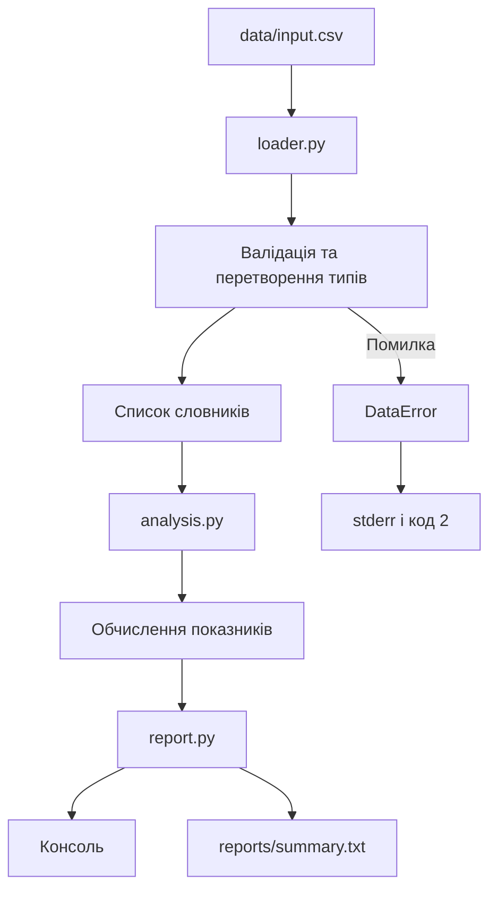

# Звіт про виконання лабораторної роботи №6

## 1. Загальна інформація

- Дисципліна: Кросплатформні засоби програмування
- Тема: Обробка даних засобами Python
- Варіант: №9 — Комунальні показники
- Виконала: Колодій Сніжана, КІ-303
- Викладач: Олексів М. В.
- Операційна система: Windows
- Середовище розробки: Visual Studio Code
- Python: 3.12.10
- Мінімальна підтримувана версія Python: 3.11
- Версія застосунку: 6.0.0
- Робоча гілка: lab6

GitHub-репозиторій:
https://github.com/snizhanakolodiiki2024-lab/kzp-labs-Kolodij

## 2. Мета роботи

Створити модульний Python-застосунок для читання CSV,
перетворення текстових полів на типізовані значення,
валідації та аналізу комунальних показників.

Реалізувати обробку даних за допомогою списків,
словників, множин і comprehensions, функцій із типовими
параметрами, *args та **kwargs.

Забезпечити формування детермінованого текстового звіту,
явну обробку помилок, автоматизоване тестування pytest,
перевірку Ruff та пакетування у форматі wheel.

### Перехід від Java до Python

Лабораторні роботи №1–5 реалізовано мовою Java.
Лабораторна робота №6 розпочинає Python-блок
того самого наскрізного продукту.

Предметна область та номер варіанта залишаються
незмінними. Java-застосунок, Maven-конфігурація
та попередні тести збережені.

Python-проєкт розміщено в окремому каталозі python
того самого GitHub-репозиторію.

Дані CSV-експорту Lab 5 використано як основу
вхідного набору Lab 6. Україномовні заголовки
адаптовано до англомовної схеми Python-застосунку.

Таким чином, Java та Python пов'язані через формат
обміну даними CSV, а не через безпосередній виклик
програмного коду іншої мови.

| Java — Lab 1–5 | Python — Lab 6 |
|---|---|
| pom.xml | pyproject.toml |
| Maven | pip та build |
| JUnit 5 | pytest |
| SpotBugs | Ruff |
| JAR | Wheel |
| Класи-сутності | Типізовані словникові записи |

## 3. Формат вхідного CSV

Файл: data/input.csv.

Кодування: UTF-8.

Роздільник: кома.

| Поле | Тип після перетворення | Призначення |
|---|---|---|
| meter | str | Назва лічильника |
| date | datetime.date | Дата показника |
| value | float | Значення споживання |
| tariff | float | Тариф |

Повний контрольний набір:

```csv
meter,date,value,tariff
Електролічильник-1,2026-11-01,125.5,4.32
Водомір-1,2026-11-02,35.25,35.2
Газовий-лічильник-1,2026-11-03,25.5,7.96
Електролічильник-2,2026-11-04,80.75,4.32
"Лічильник, ""нічний""
резервний",2026-11-05,42.75,5.1
Електролічильник-1,2026-11-06,75.0,4.32
```

Контрольний набір містить:

- шість логічних записів;
- п'ять унікальних лічильників;
- повторювану назву лічильника;
- значення точно на межі порогу 75.0;
- значення нижче та вище порогу;
- текстове поле з комою, лапками та переносом рядка.

Перші п'ять записів отримано з даних Lab 5.
Шостий запис додано для перевірки дублювання
та граничного значення.

### Правила валідації

- Заголовок повинен містити всі чотири обов'язкові поля.
- Повторювані або зайві стовпці не допускаються.
- Назва лічильника не може бути порожньою.
- Дата повинна відповідати формату YYYY-MM-DD.
- value і tariff повинні бути числами.
- Від'ємні значення, NaN та Infinity заборонено.
- Нульові числові значення дозволено.
- Відсутні та зайві поля запису відхиляються.

CSV лише із правильним заголовком є коректним
порожнім набором і повертає порожній список.

Повністю порожній файл вважається некоректним,
оскільки не містить обов'язкового заголовка.

## 4. Структура модулів

```text
python/
├── data/
│   └── input.csv
├── reports/
├── src/
│   └── kzp_lab06/
│       ├── __init__.py
│       ├── analysis.py
│       ├── cli.py
│       ├── errors.py
│       ├── loader.py
│       └── report.py
├── tests/
│   ├── test_analysis.py
│   ├── test_cli.py
│   ├── test_loader.py
│   └── test_report.py
├── .gitignore
├── pyproject.toml
├── README.md
└── REPORT.md
```

| Модуль | Призначення |
|---|---|
| __init__.py | Позначення Python-пакета |
| errors.py | Власний виняток DataError |
| loader.py | Читання, перетворення та валідація CSV |
| analysis.py | Функції аналізу даних |
| report.py | Формування та запис текстового звіту |
| cli.py | Інтерфейс командного рядка |

### Загальний потік обробки даних



CLI координує всі етапи обробки.

Поділ відповідальності дозволяє незалежно тестувати
завантаження, аналіз та формування звіту.

CLI-код не виконується під час імпорту модуля.

## 5. Перетворення даних та колекції

CSV читається через стандартний модуль csv,
а саме csv.DictReader.

Файл відкривається через Path.open з параметрами:

```python
encoding="utf-8", newline=""
```

DictReader використовує перший рядок як назви
стовпців і формує словникові записи.

Після валідації один запис має таку структуру:

```python
{
    "meter": "Електролічильник-1",
    "date": date(2026, 11, 1),
    "value": 125.5,
    "tariff": 4.32,
}
```

Для зберігання всіх записів використовується список.

Словник застосовується для агрегування споживання
за назвою лічильника.

Множина використовується для отримання унікальних
назв лічильників.

### List comprehension

```python
[record for record in records if float(record["value"]) > threshold]
```

Формує новий список записів, що відповідають
заданій умові.

### Set comprehension

```python
{str(record["meter"]) for record in records}
```

Формує множину унікальних лічильників.

Для накопичення сум за ключами використовується
звичайний цикл, оскільки він є зрозумілішим
для операції поступового оновлення словника.

## 6. Функції та параметри

Основні функції модуля analysis.py:

| Функція | Результат |
|---|---|
| filter_above_threshold() | Відібрані записи |
| sum_by_meter() | Словник сум за лічильниками |
| unique_meters() | Множина лічильників |
| total_cost() | Загальна вартість |
| max_reading() | Найбільший запис або None |
| summarize() | Вибрані підсумкові показники |

Типовий поріг:

```python
DEFAULT_THRESHOLD = 75.0
```

Функція summarize використовує типовий параметр,
довільні позиційні та іменовані аргументи.

```python
def summarize(
    records: list[dict[str, object]],
    *metrics: str,
    threshold: float = DEFAULT_THRESHOLD,
    **labels: str,
) -> dict[str, object]:
```

Параметр metrics містить кортеж назв показників.

Параметр labels містить словник альтернативних
назв показників у результаті.

Приклад виклику:

```python
summarize(
    records,
    "value",
    "cost",
    threshold=75.0,
    value="Consumption",
    cost="Cost",
)
```

Контрольний результат:

```text
count: 2
Consumption: 206.25
Cost: 891.00
```

Невідомі метрики та повторювані назви результатів
відхиляються через ValueError.

## 7. Алгоритм аналізу

Відповідно до варіанта №9 реалізовано:

1. Відбір записів за умовою value > threshold.
2. Агрегування суми value за meter.
3. Отримання множини унікальних лічильників.
4. Обчислення загальної вартості споживання.
5. Пошук найбільшого значення value.

Для вартості одного запису використовується формула:

```text
cost = value * tariff
```

Загальна вартість дорівнює сумі вартостей усіх записів.

Поріг відбору дорівнює 75.0 та може змінюватися
через параметр CLI --threshold.

Порівняння є строгим, тому запис зі значенням 75.0
не потрапляє до результату за типового порогу.

При однаковому максимальному значенні повертається
перший запис у порядку вхідних даних.

Словник агрегатів та множина лічильників
відображаються у звіті у відсортованому порядку.

### Контрольні результати

| Показник | Результат |
|---|---:|
| Кількість записів | 6 |
| Кількість унікальних лічильників | 5 |
| Сумарне споживання | 384.75 |
| Загальна вартість | 2876.81 грн |
| Найбільший показник | 125.50 |
| Кількість записів понад 75.0 | 2 |
| Сума відібраних значень | 206.25 |
| Вартість відібраних записів | 891.00 грн |

Сума значень різних типів лічильників є умовним
числовим показником навчального завдання.
Вона не є фізичною сумою споживання ресурсів
з однаковими одиницями вимірювання.

Для форматування дробових значень використовується
формат .2f.

Особливості двійкового представлення float
враховуються в тестах через pytest.approx().

## 8. Обробка помилок

Створено власний виняток:

```python
class DataError(ValueError):
    """Помилка формату або значення вхідних даних."""
```

Помилки перетворення чисел і дат обробляються
із зазначенням назви поля та номера логічного
запису з урахуванням заголовка.

Для збереження першопричини використовується:

```python
raise DataError(message) from error
```

CSV читається з параметром strict=True.

Помилки файлових операцій та декодування
перетворюються на DataError із першопричиною.

| Сценарій | Реакція програми |
|---|---|
| Відсутній файл | DataError |
| Некоректний заголовок | DataError |
| Порожнє текстове поле | DataError |
| Відсутнє значення | DataError |
| Зайве поле | DataError |
| Некоректне число | DataError |
| Від'ємне значення | DataError |
| NaN або Infinity | DataError |
| Некоректна дата | DataError |
| Пошкоджений CSV | DataError |
| Помилка запису звіту | Повідомлення в stderr |
| Однаковий вхідний і вихідний файл | Відмова від запису |

### Коди завершення CLI

| Код | Значення |
|---|---|
| 0 | Успішне виконання |
| 2 | Очікувана помилка даних, файла або аргументів |

Успішний запуск:

```powershell
python -m kzp_lab06.cli data/input.csv reports/summary.txt
$LASTEXITCODE
```

Фактичний код завершення: 0.

Помилковий запуск:

```powershell
python -m kzp_lab06.cli reports/invalid-input.txt reports/invalid-summary.txt
$LASTEXITCODE
```

Контрольний помилковий запис містить value = abc.

Фактичний результат:

```text
Помилка даних: Рядок 2: поле value має бути числом
2
```

Помилка не приховується порожнім результатом,
а користувач отримує зрозуміле повідомлення.

## 9. Формування файлового звіту

Звіт формується у модулі report.py.

Функція write_report створює вихідний каталог
і записує текст через контекстний менеджер with.

```python
with path.open("w", encoding="utf-8", newline="\n") as target:
    target.write(text)
```

Використання UTF-8 забезпечує коректне збереження
українських символів.

Параметр newline="\n" забезпечує стабільні
перенесення рядків у вихідному файлі.

Спеціальні перенесення рядків усередині назв
лічильників відображаються у текстовому вигляді \n.

Файл результату:

```text
reports/summary.txt
```

Повний фактичний текст звіту:

```text
ЗВІТ КОМУНАЛЬНИХ ПОКАЗНИКІВ
Лабораторна робота №6. Варіант №9

Кількість записів: 6
Кількість унікальних лічильників: 5
Сумарне споживання: 384.75
Загальна вартість: 2876.81 грн

НАЙБІЛЬШИЙ ПОКАЗНИК
Лічильник: Електролічильник-1
Дата: 2026-11-01
Значення: 125.50

СУМАРНЕ СПОЖИВАННЯ ЗА ЛІЧИЛЬНИКАМИ
Водомір-1: 35.25
Газовий-лічильник-1: 25.50
Електролічильник-1: 200.50
Електролічильник-2: 80.75
Лічильник, "нічний"\nрезервний: 42.75

УНІКАЛЬНІ ЛІЧИЛЬНИКИ
Водомір-1
Газовий-лічильник-1
Електролічильник-1
Електролічильник-2
Лічильник, "нічний"\nрезервний

ВІДБІР ЗАПИСІВ: value > 75.00
Кількість відібраних записів: 2
Сумарне споживання: 206.25
Вартість споживання: 891.00 грн
```

Вхідний CSV залишається незмінним.

## 10. Автоматизоване тестування

Для тестування використовується pytest 9.2.0.

Команда запуску:

```powershell
python -m pytest -v
```

| Етап | Кількість нових тестів | Загальна кількість |
|---|---:|---:|
| Loader та DataError | 22 | 22 |
| Analysis | 19 | 41 |
| Report | 4 | 45 |
| CLI | 11 | 56 |

### Перевірені сценарії

- Коректні записи.
- Порожній набір.
- Повністю порожній файл.
- Нульові значення.
- Некоректні числа та дати.
- Від'ємні значення.
- NaN та Infinity.
- Відсутній стовпець.
- Відсутнє або зайве поле.
- Пошкоджений CSV.
- Дублікати.
- Поля з комами, лапками та переносами рядків.
- Строга умова відбору.
- Порожній результат відбору.
- Агрегування за лічильниками.
- Детермінований порядок ключів.
- Функція з *args та **kwargs.
- Відсутність мутації вхідних записів.
- Формування повного текстового звіту.
- Запис UTF-8 та LF.
- Успішний і помилковий запуск CLI.
- Захист від перезапису вхідного файла.
- Відсутність запуску CLI під час імпорту.

Для роботи з тимчасовими файлами використовується
pytest fixture tmp_path.

Для перевірки декількох значень застосовується
pytest.mark.parametrize.

Для порівняння дробових чисел використовується
pytest.approx.

Фактичний результат локального тестування:

```text
56 passed in 1.39s
```

Усі тести пройшли успішно на Windows.

## 11. Якість коду та пакетування

### Віртуальне середовище

Створено середовище .venv.

```powershell
python -m venv .venv
.\.venv\Scripts\Activate.ps1
python -m pip install -e ".[dev]"
```

Використані інструменти:

| Інструмент | Версія |
|---|---|
| Python | 3.12.10 |
| pytest | 9.2.0 |
| Ruff | 0.17.6 |
| build | 1.6.1 |
| kzp-utility-report | 6.0.0 |

### Ruff

Перевірка коду:

```powershell
ruff check .
ruff format --check .
```

Фактичний результат:

```text
All checks passed!
10 files already formatted
```

Для виправлення форматування використовується:

```powershell
ruff format .
```

### Пакетування

Команда збірки:

```powershell
python -m build
```

Створені артефакти:

| Файл | Розмір, байтів |
|---|---:|
| kzp_utility_report-6.0.0-py3-none-any.whl | 7168 |
| kzp_utility_report-6.0.0.tar.gz | 9607 |

Результат:

```text
Successfully built kzp_utility_report-6.0.0.tar.gz
and kzp_utility_report-6.0.0-py3-none-any.whl
```

### Перевірка wheel у чистому середовищі

Створено окреме середовище .venv-wheel.

```powershell
python -m venv .venv-wheel
.\.venv-wheel\Scripts\python.exe -m pip install --no-deps dist/kzp_utility_report-6.0.0-py3-none-any.whl
```

У чистому середовищі встановлено лише:

```text
kzp-utility-report 6.0.0
pip 25.0.1
```

Dev-залежності відсутні.

Перевірка розташування пакета підтвердила,
що завантаження відбувається із каталогу:

```text
.venv-wheel/Lib/site-packages/kzp_lab06/
```

Запуск встановленого пакета:

```powershell
.\.venv-wheel\Scripts\python.exe -m kzp_lab06.cli data/input.csv reports/wheel-summary.txt
$LASTEXITCODE
```

Фактичний код завершення: 0.

Порівняння хешів звітів:

```powershell
(Get-FileHash reports/summary.txt).Hash -eq (Get-FileHash reports/wheel-summary.txt).Hash
```

Фактичний результат:

```text
True
```

Таким чином, встановлений wheel формує ідентичний
звіт без використання середовища розробки.

Папки .venv, .venv-wheel, build, dist, кеші,
egg-info та локальні текстові звіти ігноруються Git.

## 12. GitHub Actions

Наявна Java-інфраструктура збережена.

Для Python-частини передбачено окремий workflow
з матрицею операційних систем:

- Ubuntu;
- Windows;
- macOS.

Заплановані перевірки:

- pytest;
- ruff check;
- ruff format --check;
- пакетування wheel;
- успішний і помилковий запуск CLI;
- публікація wheel як workflow artifact.

Фактичні результати CI та посилання на артефакти
будуть додані після виконання третього рівня.

## 13. GitHub Issues та Pull Request

Розробка виконується у гілці lab6.

| Issue | Завдання | Перевірка |
|---|---|---|
| #28 | Python-проєкт та середовище | Встановлення пакета, CSV, Git |
| #29 | Loader, валідація та DataError | 22 тести |
| #30 | Аналіз даних | 19 нових тестів |
| #31 | Report та CLI | 15 нових тестів, коди 0 і 2 |
| #32 | Pytest, Ruff та wheel | 56 тестів, чисте середовище |
| #33 | Потокова обробка CSV | Заплановано |
| #34 | CI, документація та реліз | У процесі виконання |

Після завершення всіх завдань буде створено
Pull Request із гілки lab6 до main.

Закриття Issues передбачено через Closes
у фінальному Pull Request.

Версія Python-пакета: 6.0.0.

Git-тег v6.0.0 буде створено після завершення
повного циклу лабораторної роботи.

## 14. Академічна доброчесність та використання ШІ

Під час виконання лабораторної роботи використано
ChatGPT як інструмент допомоги та консультацій.

### Ролі ШІ

| Роль | Використання |
|---|---|
| Менеджер | Планування етапів та GitHub Issues |
| Розробник | Пропозиції реалізації модулів |
| Валідатор | Підбір позитивних і негативних тестів |
| DevOps | Команди venv, Ruff та пакетування |
| Документатор | Підготовка структури README та REPORT |
| Рецензент | Аналіз результатів локальних перевірок |

### Приклади запитів

- Як продовжити Java-проєкт засобами Python?
- Як організувати структуру Python-проєкту?
- Як реалізувати CSV loader для варіанта №9?
- Як перевірити коректність функцій аналізу?
- Як зібрати wheel та встановити його без dev-залежностей?

### Прийняті та змінені пропозиції

Прийнято модульну структуру Python-проєкту,
використання стандартного модуля csv,
власного винятку DataError, pytest та Ruff.

Відхилено пропозицію додавати номери Issues
безпосередньо до назв комітів.

Для комітів використовується звичайний git add .,
а зв'язок із завданнями буде задокументовано
у фінальному Pull Request.

### Виправлені проблеми

Початковий контрольний набір містив п'ять записів.
Для виконання вимог методички додано шостий запис
із повторюваним лічильником та граничним значенням.

Перший ручний помилковий запуск CLI не знайшов
контрольного файла. Після створення файла перевірку
повторено й отримано очікувану помилку числа.

### Власний внесок

Локально створено структуру проєкту та файли,
налаштовано середовища, виконано команди встановлення,
тестування, форматування, пакетування та запуску.

Створено GitHub Issues, робочу гілку та коміти.
Результати перевірок зафіксовано скріншотами термінала.

Запропонований ШІ код та документацію необхідно
перевіряти, розуміти й уміти пояснити під час захисту.

## 15. Відповіді на контрольні питання

### 1. Яку роль виконує pyproject.toml у Python-проєкті?

Файл описує конфігурацію пакета, його назву,
версію, залежності, систему збирання, CLI entry point
та налаштування інструментів розробки.

### 2. Навіщо створюється віртуальне середовище?

Воно ізолює залежності конкретного проєкту
від глобального Python та інших проєктів.

### 3. Чому CSV-файл відкривається з newline=""?

Це дозволяє модулю csv самостійно обробляти
перенесення рядків, включно з переносами всередині
екранованих полів.

### 4. Які типи повертає csv.DictReader без перетворення?

Для звичайних коректних рядків DictReader повертає
словники з текстовими ключами та значеннями.
Числа і дати залишаються рядками.

Відсутнє значення може бути None, а зайві значення
за типовими налаштуваннями потрапляють у список
під ключем None.

### 5. Чому split(",") не є коректним CSV-парсером?

Кома може бути частиною текстового поля.
Також CSV підтримує лапки та перенесення рядків
усередині екранованих значень.

### 6. Як відрізняються список, словник і множина?

Список зберігає впорядковану послідовність елементів.

Словник зіставляє унікальні ключі зі значеннями.

Множина містить унікальні елементи без гарантованого
порядку їх обходу.

### 7. Коли comprehension є зрозумілішим за цикл?

Comprehension зручний для простого відбору
або перетворення елементів.

Для складного накопичення, багатьох умов
або побічних ефектів краще використовувати цикл.

### 8. Що містять *args і **kwargs?

*args містить кортеж додаткових позиційних аргументів.

**kwargs містить словник додаткових іменованих аргументів.

### 9. Чому змінний об'єкт небезпечний як типовий параметр?

Типове значення створюється під час визначення
функції та може повторно використовуватися
між викликами.

Зміни списку або словника можуть залишитися
для наступного виклику функції.

### 10. Як raise from зберігає першопричину?

Конструкція raise NewError(...) from error
створює явний ланцюг винятків.

Першопричина доступна через атрибут __cause__.

### 11. Навіщо розділяти застосунок на модулі?

Поділ модулів забезпечує окрему відповідальність
за читання, обчислення, формування звіту та CLI.

Це спрощує підтримку, повторне використання
і незалежне тестування функцій.

### 12. Яку гарантію дає with?

Контекстний менеджер забезпечує закриття файла
після виходу з блоку, навіть якщо під час роботи
виникає виняток.

### 13. Чому звіт має бути детермінованим?

Однакові вхідні дані та параметри повинні давати
однаковий результат незалежно від випадкового
порядку обходу множин та системних налаштувань.

Це дозволяє порівнювати звіти автоматизованими тестами.

### 14. Які випадки перевіряються для порожнього CSV?

CSV лише із правильним заголовком повинен
повертати порожній список.

Повністю порожній файл повинен відхилятися
через відсутність обов'язкового заголовка.

### 15. Чим тест поведінки відрізняється від тесту реалізації?

Тест поведінки перевіряє зовнішній результат
функції або програми.

Він не залежить від конкретних внутрішніх змінних
і способу реалізації алгоритму.

### 16. Які файли знаходить pytest?

За типовими правилами pytest знаходить файли
test_*.py та *_test.py, а також тестові функції,
назви яких починаються з test_.

### 17. Які перевірки виконує Ruff?

ruff check знаходить порушення правил стилю
та типові проблеми вихідного коду.

ruff format --check перевіряє відповідність
коду правилам форматування без зміни файлів.

### 18. Які коди завершення має CLI?

Код 0 означає успішне виконання.

Код 2 використовується для очікуваних помилок
даних, файлових операцій та аргументів.

### 19. Навіщо в CI запускати тести, аналізатор і пакетування?

Тести перевіряють поведінку програми.

Аналізатор перевіряє якість вихідного коду.

Пакетування підтверджує можливість створення
артефакта для встановлення та поширення.

Разом ці перевірки забезпечують повніший контроль
відтворюваності застосунку.

### 20. Які результати потрібно зазначити у REPORT?

Необхідно описати варіант, формат CSV, структуру
модулів, алгоритми, контрольний звіт, помилки,
тести, Ruff, пакетування, GitHub Issues, CI,
використання ШІ та власний внесок.

Для повного циклу також додаються посилання
на Pull Request, зелений CI, артефакт та Git-тег.

## 16. Висновки

У лабораторній роботі №6 створено модульний
Python-застосунок для обробки комунальних показників
відповідно до варіанта №9.

Реалізовано читання CSV через csv.DictReader,
перетворення типів, перевірку даних, списки,
словники, множини та comprehensions.

Додано функції з типовими параметрами,
*args та **kwargs, власний виняток DataError
і збереження першопричини помилок.

Реалізовано детермінований текстовий звіт
та інтерфейс командного рядка.

На момент завершення інженерного етапу
успішно пройдено 56 автоматизованих тестів,
перевірки Ruff та пакетування wheel.

Працездатність пакета підтверджено встановленням
в окремому чистому віртуальному середовищі.

Збережено Java-частину попередніх лабораторних
та спільну предметну область.

Створений Python-застосунок є основою для
об'єктно-орієнтованої перебудови в лабораторній
роботі №7.